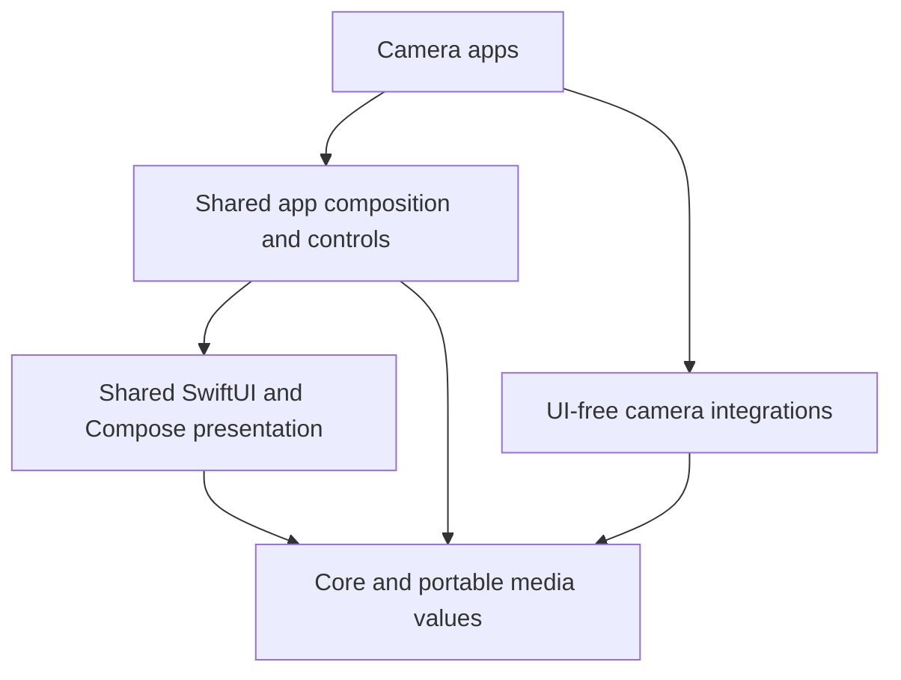

<div align="center">

# OpenCine

**The shared camera platform behind OpenCapture.**

Camera contracts, native monitoring and media, one operator interface, and camera integrations
for Swift on iOS and Kotlin on Android.

[](https://github.com/erik-sutton95/OpenCine/actions/workflows/ci.yml)
[](LICENSE)

[Developer guide](AGENTS.md) · [Atlas](atlas/README.md) · [Shared issues](https://github.com/erik-sutton95/OpenCine/issues)

</div>

OpenCine powers [OpenPocketCine](https://github.com/erik-sutton95/OpenPocketCine),
[OpenInstaCine](https://github.com/erik-sutton95/OpenInstaCine) and
[OpenZCine](https://github.com/erik-sutton95/OpenZCine). It also provides the template for new
camera apps. Apps supply their integrations, real camera observations and optional services;
shared code owns the common operator experience.

**Status: source candidate.** Shared checks, consumer verification, app pin updates and
releases have separate scopes. SIMULATED scenarios and successful builds do not qualify camera
behavior on hardware; that evidence belongs to the app and the tested camera.

## What you can build with it

- Camera connections, saved-camera records, setting descriptors and observed values.
- A common monitor, capture controls, assist inspectors, cameras page and operator settings.
- Native live picture and clip playback, media delivery, calibration and effects processing.
- Multicam policy, relay and watch components, with explicit ownership and optional services.
- UI-free DJI, Nikon and Insta360 integrations, composed by each app.

Features follow the connected camera's capabilities and services. Unsupported or unknown values
remain absent: unknown is `nil`, not a guessed `false`, zero or empty string. Integration-specific
controls enter through typed, bounded content; they do not replace shared screen composition.

## Start here

For the shared Swift package, use a compatible Swift toolchain and Xcode on macOS. The manifest
declares Swift tools 6.0; CI selects the latest stable Xcode. Android CI uses JDK 21 with the
Android SDK and the checked-in Gradle wrapper. Its Java/Kotlin bytecode target is a separate
setting. Python 3 runs the atlas without additional Python dependencies.

```sh
git clone https://github.com/erik-sutton95/OpenCine.git
cd OpenCine
swift build --build-tests
swift test
python3 atlas/tools/atlas.py check
```

To work with the camera apps, the atlas checks and creates sibling checkouts:

```sh
python3 atlas/tools/atlas.py ensure --check
python3 atlas/tools/atlas.py ensure
python3 atlas/tools/atlas.py locate openpocketcine
python3 atlas/tools/atlas.py impact OpenCineMedia
```

An app's `opencine-pins.txt` records its shared source commit. Candidate checkouts use a sibling
Swift package and Gradle composite build; app CI checks out the pinned commit. Run the app's own
checks after changing shared behavior. [AGENTS.md](AGENTS.md) describes task worktrees and
[atlas/docs/PUBLISH.md](atlas/docs/PUBLISH.md) describes publishing and reviewed app pin moves.

## Architecture



This is a layer overview. [Package.swift](Package.swift) and
[Android/settings.gradle.kts](Android/settings.gradle.kts) list the products and modules;
their target dependencies and the area guides define the precise allowed edges.

| Area | Guide |
| --- | --- |
| Contracts and portable media | [Core](docs/core/README.md) |
| Monitor presentation and native runtime | [UI](docs/ui/README.md), [native runtime](docs/native-runtime/README.md) |
| App composition and shared controls | [AppKit](docs/appkit/README.md) |
| Multicam | [Multicam](docs/multicam/README.md) |
| Camera integrations | [DJI](docs/dji/README.md), [Nikon](docs/nikon/README.md), [Insta360](docs/insta360/README.md) |
| SIMULATED developer harness | [Harness](docs/harness/README.md) |
| Repository routing and compatibility | [Atlas](atlas/README.md) |

The Swift package declares no external package dependencies. Existing Android dependencies are
specified in its version catalog. Shared UI and app composition never import an integration or
branch on a manufacturer; apps compose the integration and supply values and actions.

## Build and verify

Run these from the repository root:

```sh
swift build --build-tests -Xswiftc -strict-concurrency=complete
swift test --skip-build -Xswiftc -strict-concurrency=complete
xcodebuild -scheme MonitorUI -destination 'generic/platform=iOS Simulator' build
xcodebuild -scheme OpenCineApple -destination 'generic/platform=iOS Simulator' build
xcodebuild -scheme Insta360Apple -destination 'generic/platform=iOS' CODE_SIGNING_ALLOWED=NO build
(cd Android && ./gradlew test lint assembleRelease)
scripts/android-vulkan-sync-test.sh
python3 -m unittest discover -s atlas/tests
python3 atlas/tools/atlas.py check
```

The Vulkan host regression needs NDK Vulkan headers. The CI workflow also checks Core and
Multicam with warnings as errors and runs the generated-app SIMULATED checks.
Build and test results apply to the checked source; they are not a claim that every app or
hardware feature is currently qualified. See the [device testing guide](docs/testing/TESTER-GUIDE.md)
for app-specific verification, and [retired owners](docs/testing/RETIRED-OWNERS.md) for the shared
source migration record.

## Navigate with the atlas

The atlas routes issues, identifies consumers and records compatibility. It is standard library
Python, reads manifests and Git, and is a developer tool, not a product dependency. Current
source, manifests and exercised evidence remain authoritative. See [atlas/README.md](atlas/README.md).

## Contribute and report

Read [CONTRIBUTING.md](CONTRIBUTING.md), [AGENTS.md](AGENTS.md) and the
[Code of Conduct](CODE_OF_CONDUCT.md). Report app setup or camera behavior in the app's tracker;
report confirmed shared-code problems [in OpenCine issues](https://github.com/erik-sutton95/OpenCine/issues/new/choose).
Report vulnerabilities privately through [SECURITY.md](SECURITY.md).

## Support

Optional [Buy Me a Coffee](https://buymeacoffee.com/eriksutton) contributions support
OpenCapture development. Using the apps, reporting a clear issue and contributing a patch
are welcome too.

## Versions and license

Shared products use one semantic version and tag. Shared changes land here first; each app moves
its pin in a reviewed update and verifies the behavior before shipping. Below 1.0, incompatible
interfaces require a minor version increment. The [publish guide](atlas/docs/PUBLISH.md) records
the release process.

Apache License 2.0: [LICENSE](LICENSE), [NOTICE](NOTICE) and
[THIRD-PARTY-NOTICES.md](THIRD-PARTY-NOTICES.md). Bundled resources retain their own notices.
DJI, Nikon, Insta360 and Luna names identify their respective owners; this project is not
affiliated with or endorsed by them.
