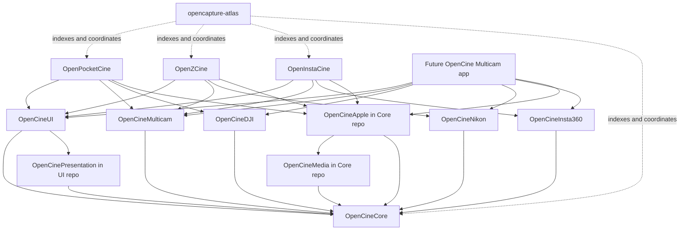
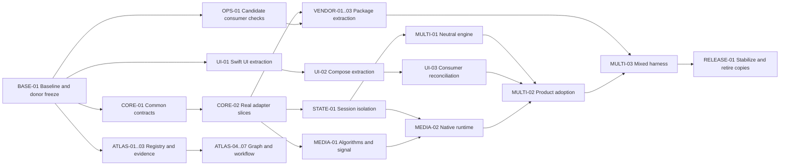

# OpenCine platform and OpenCapture Atlas plan (Atlas copy)

> **About this copy.** Atlas-owned copy of the 2026-10-01 platform plan, kept for routing and
> work-package briefs. Changes from the personal original, and nothing else:
>
> 1. Every absolute local path is converted to `repo-id@<full SHA>:<relative path>` at the
>    revision the plan inspected (`openpocketcine@3cf8187c...`, `openinstacine@35b6f33b...`,
>    `openzcine@9ac41387...` for main and `openzcine@ef38a264...` for the engine-port worktree,
>    `prior-atlas@296bd295...` for the unregistered donor). Machine paths live only in ignored `.local/` configuration.
> 2. Em dashes after work-package IDs are replaced with colons; workspace folders read `<workspace>`.
> 3. Section 14.4's identity sentence and the 15.3 hosting row are replaced by Atlas
>    notes pointing at [PUBLISH.md](../PUBLISH.md).
>
> Facts that changed after the plan was written are recorded in
> [BASE-01.md](../baseline/BASE-01.md) and the [decisions](decisions/), not edited here. For
> example, the Pocket vertical-raster fix is merged (#482), and the BASE-01 Pocket baseline is
> `27b15028`.

**Date:** 2026-10-01  
**Status:** Proposed architecture, grounded in inspected local repositories.  
**Scope of this work:** Inspection and this plan only. No application code was refactored, no packages were extracted, and no repositories were created.  
**Execution rule:** A later implementation task should select explicit work-package IDs from this document. This document is not an instruction to implement every phase automatically.  
**Naming:** Retain `OpenCineCore`, `OpenCineUI`, `OpenCineMulticam`, and the manufacturer package names from the original proposal. Use the explicitly requested `opencapture-atlas` for the development knowledge and coordination repository. These names describe different responsibilities; a wholesale product rename is outside this plan.

## Contents

1. [Recommendation and changes to the original proposal](#1-recommendation-and-changes-to-the-original-proposal)
2. [Inspection baseline and evidence](#2-inspection-baseline-and-evidence)
3. [Repository and package architecture](#3-repository-and-package-architecture)
4. [Source ownership and extraction inventory](#4-source-ownership-and-extraction-inventory)
5. [Common camera, monitoring, and capability models](#5-common-camera-monitoring-and-capability-models)
6. [Streams, processing, color, and runtime ownership](#6-streams-processing-color-and-runtime-ownership)
7. [OpenCineUI and the UI 2.0 design system](#7-opencineui-and-the-ui-20-design-system)
8. [Manufacturer-independent multicam](#8-manufacturer-independent-multicam)
9. [Manufacturer integrations and specialized features](#9-manufacturer-integrations-and-specialized-features)
10. [Versioning, local development, and releases](#10-versioning-local-development-and-releases)
11. [Testing and continuous integration](#11-testing-and-continuous-integration)
12. [OpenCapture Atlas architecture](#12-opencapture-atlas-architecture)
13. [Migration work packages](#13-migration-work-packages)
14. [Agent execution protocol and handoffs](#14-agent-execution-protocol-and-handoffs)
15. [Risks, decisions, and completion criteria](#15-risks-decisions-and-completion-criteria)
16. [Evidence index and documentation references](#16-evidence-index-and-documentation-references)

## 1. Recommendation and changes to the original proposal

The architecture still makes sense. Current code provides stronger evidence for it than a purely conceptual comparison of three camera brands would. UI sharing is immediately justified; universal camera and multicam abstractions need a more careful transition.

The recommended destination remains:

- A shared engine and domain model in `OpenCineCore`.
- A shared design system and native UI implementations in `OpenCineUI`.
- A presentation-independent multicam engine in `OpenCineMulticam`.
- Manufacturer packages translating each ecosystem into the common model.
- Independently buildable and releasable brand applications.
- `opencapture-atlas` as the place to understand and coordinate work across those repositories.
- A possible future neutral multicam application that composes several integrations.

### 1.1 Keep, modify, add, and defer

| Decision | Recommendation | Reason from current repositories |
|---|---|---|
| Shared UI based on Pocket UI 2.0 | Keep; make this the first substantial extraction | Pocket and Insta already duplicate almost exactly the same presentation, SwiftUI, and Compose code. Nikon's engine-port branch also adapts it. |
| Separate Core and UI repositories | Keep | They have distinct responsibilities and should enforce import restrictions. |
| Separate multicam engine | Keep; create its repository when an exercised engine is ready | Existing multicam orchestration is still vendor-specific. Extracting whole session classes now would preserve that coupling. |
| Manufacturer integrations | Keep; first establish local package seams inside current app repos | Relocation should follow working interfaces, avoiding simultaneous protocol rewrites and repository moves. |
| Swift Package Manager instead of submodules | Keep for Swift | Android also needs Gradle artifacts and native library packaging. SPM alone does not cover the existing products. |
| Everything neutral in one Core target | Modify | Use a few products inside one Core repository: portable contracts, media algorithms, Apple runtime, and optional external-service modules. Keep heavy or platform-specific dependencies out of the minimum contract closure. |
| Multicam accepts only `CameraSession` | Modify | Accept monitoring entries with optional picture and control roles. Nikon already has HDMI and relay cases, and controls can remain useful without a displayed picture. |
| Capabilities as booleans | Replace as the domain model | Values, current writability, mode restrictions, confirmation behavior, provenance, and control authority all matter. A small boolean projection can remain useful for UI layout. |
| One neutral stream of `Data` | Replace | Codec, timing, generation, dimensions, color interpretation, orientation, and lifetime must be explicit. Keep compressed data and decoded surfaces distinct. |
| Generic UI owns all camera-specific behavior | Refine | Shared UI owns common interactions. Apps can inject specialized panels backed by a typed integration interface. |
| Shared global state | Narrow | Share state types and reducers. Each camera, stream, editor, profile, and operation owns its own state. |
| Cross-brand multicam | Preserve architectural support; defer product commitment | Physical network topology and camera limitations may prevent particular combinations even when software interfaces support them. |
| Shared motion/tracking | Add as optional capabilities | DJI and Luna now have meaningful common motion workflows, but not interchangeable command semantics. |
| Knowledge workspace | Add `opencapture-atlas` early | It can keep extraction ownership, dependency maps, branch provenance, and cross-repository tasks navigable. |
| New repositories for every feature | Reject | No separate repository for every scope, transport, platform backend, or utility. |
| Neutral standalone app now | Defer | A test harness proves composition before a new product adds store and support obligations. |

### 1.2 Changes since the earlier assessment that matter

1. **UI sharing is measurable.** Against Pocket's inspected `origin/main`, all 31 Insta `MonitorPresentation` Swift files are identical; 34 of 35 `MonitorUI` Swift files are identical; 62 of 63 Kotlin files under `monitor-ui` are identical. The remaining differences are theme files. The Kotlin count includes tests. This is an extraction opportunity, not a speculative redesign.
2. **Nikon should participate early.** Its unmerged `feat/monitor-engine-port` worktree already has the neutral presentation/UI targets and Nikon adapters. Do not wait until the end to test whether the common model fits Nikon.
3. **The old Nikon ambient-JNI-session problem has been addressed on that branch.** Its owner-keyed registry is a useful donor. Cached main still differs. Do not describe the branch as if the fix is missing, or describe main as if the branch is merged.
4. **Pocket Multi View has evolved.** Retained video hosts, per-camera settings leases, record-confirmation context validation, and shared network setup chrome need to be preserved. A plan based only on older grid tiles would discard useful behavior.
5. **Insta's contracts are not yet a complete neutral control path.** Apple controls still reach concrete Luna types and requests. Naming an interface `CameraBackend` has not made every operation pass through it.
6. **Telemetry quality must be explicit.** Insta's picture-derived EV estimate and reconstructed clock display are useful, but are not interchangeable with camera-reported exposure or synchronized source timecode.
7. **Mixed-camera state contamination is a real risk.** Luna's process-wide session hub and media settings, Pocket's global false-color reading preference, and Insta's shared EV calibration need session-scoped ownership.
8. **The atlas pattern needs adaptation.** A prior local atlas provides a practical foundation, but its existing scanner omits important Swift/Xcode dependency evidence and its snapshot metadata is not sufficient for reproducible source attribution.

### 1.3 Practical scope for one developer

Create repositories when there is code ready to consume, rather than creating six empty package repositories and maintaining speculative contracts in each.

Recommended sequence of repository creation:

1. `opencapture-atlas`, as a small routing and evidence workspace.
2. `OpenCineCore` and `OpenCineUI`, once the initial extraction inventory is frozen.
3. `OpenCineMulticam`, after the neutral engine works against real adapters or faithful adapter fixtures.
4. `OpenCineDJI`, `OpenCineNikon`, and `OpenCineInsta360`, as each integration is independently package-buildable and has a proven external consumer.
5. A neutral app only after capability, topology, and performance qualification.

The final six shared/integration repositories are a reasonable destination. The maintenance burden comes from independent release surfaces and unreliable coordination, not simply their count. During migration, a manufacturer Swift package may live under its current app repository and be exercised through local path dependencies. That is a temporary packaging location, not copied shared code. A normal remote SwiftPM dependency resolves the package at the repository root; consumers cannot simply select an arbitrary nested package directory. Before remote distribution, give the integration its own package-root repository or an explicitly designed root manifest. Once extracted, every consumer uses its versioned package/artifact.

Do not create a second platform umbrella runtime, a dependency-injection framework, a generic workflow language, or a universal plugin registry just to support three integrations. An explicit list of integration factories at the application composition root is enough.

## 2. Inspection baseline and evidence

### 2.1 Inspected local repositories and branches

These are the inspection snapshots, not instructions to reset anyone's checkout. Recheck them before execution; active development can change the answer.

| Repository/worktree | Inspected state | Interpretation |
|---|---|---|
| `openpocketcine` primary checkout | Clean checkout on `fix/android-portrait-rec-setup`, `662b75cdeea07a04d041a5155246ddf250b5bb1f` | The working directory is not current main. Main-source inspection used Git objects explicitly. |
| Pocket cached `origin/main` | `3cf8187c25c640e47ad799983a9537c7d505bbf0`, Sep 30 | Main architecture baseline. Public main SHA was separately checked and matched at inspection time. |
| Pocket local vertical-feed worktree | `fix/android-vertical-feed-crop`, `7ee6df1981aedd62df88681f5021faef6c8a2ac3`, Oct 1 | Relevant in-flight Android upright-raster fix. Preserve it when choosing renderer donors; not silently treated as merged. |
| `openinstacine` primary checkout | Clean local `main`, `35b6f33b20cbd791a4c24b6380046f180f1ee454`, Sep 30 | Four local maintenance commits ahead of cached origin/main. |
| Insta cached `origin/main` | `539a292` | Remote-tracking baseline is local cached evidence, not a claim that a fetch occurred. |
| `openzcine` primary checkout | Contains unrelated dirty spike work | Preserved. Cached-main inspection used object reads. Do not use this working tree as an extraction source without reviewing its changes. |
| Nikon cached `origin/main` | `9ac413876ddc663e95edb6cf7913f2aa73ea03b3`, Sep 30 | Merged baseline represented by local remote-tracking ref. |
| `openzcine` engine-port worktree (folder named `main`) | Clean `feat/monitor-engine-port`, `ef38a2646e49c248c089d6bf5d7bfca1c836dd62`, Sep 29 | Important unmerged donor. Its directory name does not mean it is the main branch. Earlier `feat/multicam` is an ancestor of this branch. |
| `prior-atlas` checkout | Clean local `main`, `296bd295`, Sep 21; one commit behind cached `origin/main` `c6edf663` | Local donor for atlas structure/tooling. The cached Sep 23 update makes AGENTS.md the sole agent instruction file; it does not change graph tooling. |

The earlier Insta baseline identifier `426d782` could not be found in its current object database. This review therefore does not claim a verified ancestor diff from that identifier.

The old task folder `<orca-workspace>/OpenPocketCine/Restructuring` no longer exists. It is not a suitable output location or source of current code. The final plan is saved as a standalone document under `<workspace>/`.

### 2.2 Evidence hierarchy

Use this order when documents disagree:

1. The selected source revision and actual package/project/build manifests.
2. Exercised tests and captured hardware evidence for that revision.
3. Current implementation documentation whose paths resolve at that revision.
4. Architecture proposals and historical documents.
5. Generated graph relationships and summaries, which are navigation aids.

Examples of why this matters:

- Insta architecture prose refers to paths/products such as `MonitorCore`, `Adapters/OsmoCompatibility`, `Shared/Apple/MonitorUI`, and `Apps/Apple` that do not match the inspected current structure.
- A neutral `MonitorContracts` target exists, but actual Apple control paths bypass parts of it.
- Nikon's engine-port contains work not on cached main, including multicam and owner-scoped JNI behavior.
- An inherited Multi View source file in Insta is not evidence that Luna Multi View is supported.

No application build, simulator run, new graph build, or physical camera test was performed for this architecture review. Proposed verification gates below are future work; existing source tests are evidence of intent, not a fresh passing run.

## 3. Repository and package architecture

### 3.1 Repository responsibilities

| Repository | Owns | Explicitly outside its ownership |
|---|---|---|
| `OpenCineCore` | Common domain values, session interfaces, capability/observation models, portable media math, common processing policy, native media runtime products, optional reusable Frame.io/relay modules | Manufacturer protocols, product branding, store configuration, shared SwiftUI/Compose widgets |
| `OpenCineUI` | UI 2.0 tokens, presentation rules, SwiftUI/UIKit wrappers where needed, Compose equivalents, common screen sections, monitor/multiview chrome | Connection ownership, raw camera commands, vendor detection, media protocol parsing |
| `OpenCineMulticam` | Entry membership, selection, operation planning, group command outcomes, demand budgeting, per-entry health aggregation | Widgets, Bluetooth/network protocol implementation, vendor-specific camera setup |
| `OpenCineDJI` | DJI discovery, DUML and datalink details, settings translation, device profiles, camera-specific recovery/provisioning | General monitor rendering or shared UI |
| `OpenCineNikon` | PTP/IP/USB and Nikon semantics, discovery policy, control pump, profiles and confirmation | Shared layout or universal camera assumptions derived from PTP opcodes |
| `OpenCineInsta360` | Luna protocol/SDK adapters, discovery/connect rules, confirmation delays, profiles, gimbal mapping | Shared UI theme or process-wide configuration of other integrations |
| Brand apps | Composition, branding, lifecycle, entitlements, permissions, release configuration, app-owned credentials/preferences, specialized view composition | Duplicated shared implementations after their extraction is complete |
| `opencapture-atlas` | Repository registry, source maps, consumer index, architecture decisions, cross-repo task and compatibility records, navigation evaluations | Production source ownership, app releases, runtime dependency resolution |

### 3.2 Products within the Core repository

The repository name is not a mandate for a single enormous Swift target. Start with only products that have an immediate consumer:

| Product/target | Purpose | Dependency rule |
|---|---|---|
| `OpenCineCore` | Portable common models and small session/integration interfaces | Foundation-level dependencies only where practical; no other OpenCine package |
| `OpenCineMedia` | LUT parsing, signal/analysis configuration, scope math, geometry, frame timing, bounded processing policies | Depends on `OpenCineCore`; no UI or vendor packages |
| `OpenCineApple` | VideoToolbox/CoreVideo/Metal and Apple source/runtime adapters | Depends on Core/Media; OS frameworks are contained here |
| `OpenCineFrameIO` | Request construction, upload workflow/state, portable service models | Optional product; depends on Core only where shared values genuinely help |
| `OpenCineRelay` | Optional relay framing, stream/control authority models and transport runtime | Add only when extracted; depends on lower Core products, never an app |
| Test support target | Fakes, recorded fixtures, shared conformance suite utilities | Test-only dependency; not part of production package closure |

Use internal folders before introducing additional public targets. `OpenCineMedia` earns a separate target because algorithms and native processing have different dependencies and test environments. Individual scopes do not each need a target.

An Apple capture source can live in `OpenCineApple` even though it is not a manufacturer integration. This is how HDMI/UVC/capture-device picture sources participate without being forced into a Nikon package.

Optional products should keep their dependencies out of the linked target closure. Verify actual package resolution behavior for any heavy third-party dependencies; multiple products in one package do not magically make all manifest dependencies invisible to the resolver. Measured 2026-10-12 (F01): a sentry-cocoa dependency in the OpenCine manifest made every dependent package (OpenZCine's root package, the Android Swift builds) resolve and download the SDK's binary artifacts although no target used it. The optional reporting adapter therefore is its own package, `Packages/OpenCineSentryApple` (Android `:appkit-sentry`, which Gradle resolves only for modules that use it); the OpenCine package keeps no dependencies, and no OpenCine target or module depends on the adapter.

### 3.3 Products within the UI repository

Preserve existing useful module seams:

- `OpenCinePresentation`: pure layout/interaction/presentation values, evolving from `MonitorPresentation`.
- `OpenCineUI`: shared SwiftUI views and UIKit wrappers, evolving from `MonitorUI`.
- Android `monitor-ui`: Compose implementation of the same design and behavior contract.
- Android presentation logic: initially keep its existing tested language implementation; extract a dedicated module only when a separate consumer justifies it.

To keep the first PR small, the repository can initially export the current module names `MonitorPresentation` and `MonitorUI`. A repository/package name need not equal every import name. Rename imports in a later mechanical change if desired; do not combine that with semantic UI changes.

UI multiview surfaces consume presentation values and action closures. They do not need to import `OpenCineMulticam`. The app, or a tiny app-side presenter, maps engine snapshots to those values. If that mapping becomes substantial and repeats, a later optional binding target can depend on both. Do not introduce it as a pass-through layer in advance.

### 3.4 Dependency graph

An arrow means “depends on.” App arrows represent composition of all listed products; Atlas is deliberately outside the runtime graph.



Applications also directly depend on common Core values where used; these repetitive arrows are omitted for readability. Optional Frame.io/relay products are composed by applications and do not reverse this graph.

Enforce these rules in import/build checks:

- Core never imports a manufacturer integration, UI, or Multicam.
- Manufacturer packages never import UI or app targets.
- Multicam never imports manufacturer packages or UI.
- UI never imports manufacturer packages or app targets.
- The app may import all required lower-level products and owns their assembly.
- No package uses Atlas as a build dependency.

### 3.5 Android is part of the platform

The current products have substantial Android implementations. A Swift-only extraction would leave much of the duplication intact.

Each shared repository may contain both its Swift package and Android build:

```text
OpenCineUI/
  Package.swift
  Sources/
  Tests/
  Android/
    settings.gradle.kts
    monitor-ui/
  Resources-or-platform-specific-resource-folders/
  docs/
```

Keep native Swift protocol reuse where it already works. Keep Luna's Kotlin protocol implementation where it is currently exercised. Share contracts, fixtures, and behavior; do not require a language rewrite before code sharing.

Android native packaging needs an explicit policy for Swift/JNI libraries, C++/Vulkan, ABIs, toolchain versions, symbols, and native runtime dependencies. A future app including several integrations must not bundle conflicting copies of the same native library or rely on a global current camera. Establish one coherent native dependency closure and owner-scoped entry points. Preserve Nikon's engine-port owner registry contract as a donor and test all teardown/completion paths with two concurrent owners.

## 4. Source ownership and extraction inventory

The following are source candidates, not a command to move entire files unchanged. Many current files combine neutral algorithms with vendor-specific assumptions. Split at the exercised interface first, then relocate.

Paths in this section are repository-relative to the baselines in section 2. Pocket paths refer to its inspected main unless otherwise stated. Existing symbols are useful evidence; proposed names are not claims of existing implementation.

### 4.1 Core and media donors

| Existing source/system | Destination | Required preparation |
|---|---|---|
| Pocket `CubeLUT.swift`, `CustomLUTIndex.swift`, `LUTExposureCompensation.swift` | `OpenCineMedia` | Separate file-storage preferences and vendor bundled LUT selection from cube parsing/interpolation/math. Preserve import and malformed-file tests. |
| Pocket `LiveColorScience.swift`, `LogColorTransform.swift`, `MonitorLUT.swift` | Core/Media algorithms plus integration-owned profiles | Remove the assumption that all log curves and clipping limits are DJI modes. Pass a signal profile and analysis configuration. |
| Pocket `ShutterAngle.swift`, frame-rate utilities | Core/Media | Use rational recording rate and duration; preserve supported-value quantization in adapters. Preview rate is a different observation. |
| Pocket `LiveFrameTap.swift`, `FrameRateSampler.swift`, `FeedPresentPolicy.swift`, processing admission | Media/runtime | Preserve bounded work, generation checks and ownership. Review any datalink-specific thresholds before generalizing. |
| Pocket `LiveFrameSample.swift`, `LiveScopes.swift`, `ScopeTraceMetalView.swift` | Split Media/runtime computation from UI presentation | Retain one shared sample pass, encoded/native-code semantics, monitor-domain vectorscope conversion, and immutable published results. Remove `CameraStatus`/DJI color mapping from shared sampling. |
| iOS `HevcDecoder.swift`; Android `session/HevcDecoder.kt` | Shared platform runtime | Separate codec lifecycle from camera reconnect. Support declared codec/config changes rather than assuming all sources are HEVC. |
| Android `opc_vulkan.cpp`, `VulkanPresentBatch.h`, native present/capture support | Core media runtime's Android implementation | Preserve upright-raster/aspect fixes and latest valid image/surface lifetime. Reconcile Pocket's Oct 1 unmerged fix before donor freeze. |
| `PortraitFeedAspect.swift`, overlays, safe areas, aspect calculations | Core/Media values; UI drawing in UI | Distinguish sensor/raster orientation, clean aperture, mirror, user rotation, display fit, and recording framing. |
| `ReconnectBackoff.swift`, value pinning/mailbox policy | Core only after protocol assumptions are removed | Per-session clock/operation identity. Keep vendor retry/ACK strategies in adapters. |
| `FeedIncident*`, connection timelines, health models | Core diagnostic event model plus app-configured sinks | Redact sensitive network/credential fields; preserve per-camera/attempt correlation. The Sentry sink, transport and upload are the optional adapter products `OpenCineSentryApple` and `:appkit-sentry` (the one exception to "no third-party package", 2026-10-12, F01); the app keeps its host values, DSN and project. |
| Frame.io model/request/upload logic | Optional `OpenCineFrameIO` product | Separate HTTP state machine from authentication presentation, callback URL schemes, secrets, and app storage. Compare Nikon donor before choosing implementation. |
| Recording/export/local conform utilities | Media and optional workflow module within Core repo | Distinguish remote camera recording from phone-side capture, playback downloads, transcoding and upload jobs. Extract exercised shared behavior only. |
| Network helpers | Core/native runtime only where neutral | Generic reachability/path facts and HTTP helpers may share. DUML/PTP/Luna sockets, discovery safety and provisioning remain vendor-owned. |

### 4.2 UI 2.0 donors

| Existing group | Shared destination | Extraction detail |
|---|---|---|
| `Sources/MonitorPresentation/*` | `OpenCinePresentation` | First mechanical donor. Preserve existing tests and public behavior. Evolve `MonitorCapabilities` later as a projection of richer Core values. |
| `MonitorTheme`, font/icon resources, `MonitorGlassSurface`, motion | `OpenCineUI` theme/tokens/resources | Inject brand accents and app identity. Keep typography, spacing, materials and interaction timing consistent. |
| `MonitorChromeButton`, `MonitorControls`, `MonitorValueDrum`, `MonitorDurationDial`, `MonitorZoomDial` | Shared controls | Supported values and units come from descriptors; gesture/haptic/accessibility behavior remains shared. |
| `MonitorInspector`, environment, capture panel/tabs, segmented controls, tab strip | Shared panels/navigation sections | Slots and typed actions replace access to concrete app models. |
| `MonitorCanvas`, backdrop renderer, window geometry, preview admission | UI/runtime seam | UI owns placement; runtime owns source/surface/frame lifetime. Preserve stable video-host mounting. |
| `CameraPageChrome`, `CamerasPage`, `PairCameraPage` | Shared camera listing/onboarding presentation | Discovery/provisioning operations supplied by adapters. Passive-only Nikon discovery must remain possible. |
| Media catalog/filter/selection/playback chrome/scrubber | Shared media UI | Consume common media descriptors; downloading and playback delivery belong below UI. |
| Assist palette/icons, gauges, scope placement, error/recovery presentation | Shared monitor HUD | Values and availability come from source/session snapshots. No direct DJI mode switch. |
| `MonitorScrollFade`, `MonitorTabStrip` | Include in current baseline | These are newer shared components and should not be lost by extracting an older UI2 snapshot. |
| `Apps/Android/monitor-ui` in all three apps | Shared Compose artifact | Reconcile theme differences; preserve behavioral and screenshot fixtures alongside SwiftUI contracts. |

Do not wholesale move `AppModel`, `CameraSession`, `NativeAppRoot`, or a large current monitor view into UI. Those objects carry application and camera ownership. Extract specific view sections with explicit input values and actions.

### 4.3 Multi View donors

| Existing system | Shared engine | Shared UI | Vendor/application work retained |
|---|---|---|---|
| `MultiviewPresentationLayout` | None | Grid/stage sizing, orientation and secondary-strip placement | Product default layout preferences |
| Pocket `MultiviewStageCanvas` and Android tile canvas | None | Retained host identity/reparenting behavior | Runtime surface supplied by source owner |
| Pocket `MultiviewSession` | Membership/selection/operation patterns after separation | Snapshot mapping only | `FoundCamera`, DUML status, `DatalinkDriver`, profile selection and concrete decoder construction extracted elsewhere |
| Pocket `MultiviewCameraSettings` | Control lease validity and editor ownership | One editor, camera tabs, reusable setting controls | Vendor setting commands and confirmation strategies |
| Pocket `MultiviewRecordAction` | Stable operation plan/context and invalidation | Confirmation dialogue and record button | Translation to idempotent start/stop operations |
| Pocket `MultiviewRecovery` | Bounded retry budget/health aggregation if neutral | Per-tile recovery state | Current watchdog's UDP/GOP/camera-SET assumptions remain adapter-specific |
| Pocket discovery/network/provisioner/store | Admission and resource claims only | Shared setup form chrome | DJI station join and BLE compensation/cleanup, credential storage, OS hotspot operations |
| Nikon `MulticamCoordinator` | Group/member lifecycle and mixed-result patterns | Presentation snapshot | PTP types, `UIImage`, `Timecode`, host/path identity and fixed limit cannot migrate unchanged |
| Nikon `GroupRecord` | Per-camera outcome model and explicit target policy | Aggregate plus individual outcomes | PTP confirmation/readback |
| Nikon tile-to-Live-View handoff | Owner/lease lifecycle | Selection/expanded view | Existing session remains owned; avoid competing pumps |

### 4.4 Manufacturer ownership

- **DJI:** `DumlFrame`, `DumlTransport`, `DumlNotificationAssembler`, `Commands`, BLE advertisement decoding, DJI `CameraModel`/raw status and mode enums, datalink handshake/admission, station join, device discovery, network provisioning quirks, DJI media endpoints, device-specific recovery ladders and profile data.
- **Nikon:** PTP commands/property descriptors and raw values, PTP/IP/USB transports, safe discovery behavior, transaction/control pump, pairing records, Nikon confirmation/timecode/profile mapping, model-specific recording restrictions and live-view acquisition.
- **Insta360:** Luna wire requests, Apple backend, Kotlin `luna-adapter`, device discovery/connection rules, stream unframing, image/profile detection hints, delayed setting readback, camera clock translation evidence, gimbal units/bounds/feedback quirks and SDK wrappers if actually used.

Common H.264/H.265 bitstream parsing can be shared. A packet depacketizer is shared only when its wire format is genuinely common; similarly named camera transports are not proof.

### 4.5 Application ownership

Applications retain:

- Application entry point, lifecycle and foreground/background policy composition.
- Brand name, bundle/application ID, icons, permitted theme overrides and onboarding copy.
- Entitlements, privacy descriptions, permission requests and OS scene configuration.
- Store metadata, signing, provisioning, release notes, version/build numbers and distribution workflows.
- Analytics/crash-reporting configuration and user consent controls, if present.
- OAuth callback registration, app-owned secure credential storage, persistence migration entry points.
- Selection of enabled integrations and optional features.
- Product support policy: which cameras/routes/combinations are qualified and visible.
- A small composition layer for typed manufacturer-specific panels.
- Unique workflows until a second real consumer demonstrates useful shared behavior.

“Thin shell” does not mean a fixed line-count goal. A shell can contain substantial product configuration and platform lifecycle handling without duplicating camera protocol or monitor-engine implementation.

## 5. Common camera, monitoring, and capability models

### 5.1 Design the minimum exercised model

Begin with DJI, Nikon, and Luna adapters plus one capture-only fixture. A common interface is accepted when these can use it without manufacturer checks in shared UI or multicam. A type rename or empty protocol conformance is insufficient.

Use value types for descriptions, snapshots, settings, observations and results. Use a small number of interfaces at points where implementations actually vary: integration discovery/session creation, camera session, picture source, and optional specialized services. Internal implementation classes do not each need a protocol.

### 5.2 Identity and ownership

| Concept | Meaning | Important distinction |
|---|---|---|
| `IntegrationID` | Stable namespaced provider identifier, e.g. a DJI integration | Useful for registration and diagnostics, not UI feature gating |
| `CameraDeviceID` | Persisted identity of the physical device when known | Neither IP address nor current discovery sighting alone is sufficient |
| `ConnectionRouteID` | Saved setup/path: USB, a station network, camera AP, relay route | One camera can have several routes |
| `ConnectionAttemptID` | One attempted connection, including recovery | Prevent stale asynchronous completion from affecting a replacement attempt |
| `CameraSessionID` and control epoch | One owned live camera-control lifetime, with an epoch for authority/link replacement | Detail views borrow access; they do not create another physical link. A picture-format change alone does not change control ownership. |
| `StreamID` and generation | One picture stream and its current format/lifetime epoch | Reconnect/reconfigure invalidates old frames even if device ID is unchanged |
| `MonitorEntryID` | Stable UI/multicam slot identity | Reordering, stage selection and rotation preserve it |
| `OperationID` | A command or workflow intent and its results | Separate from telemetry revisions |

If a device has no durable serial-like identity, the integration supplies an explicitly provisional identity with reconciliation rules. Common code must not silently merge two devices because they share a host address, display name, or model. Credentials are referenced by opaque IDs, not embedded in these identifiers or graph snapshots.

### 5.3 Monitoring entries compose picture and control

Use a concrete aggregate such as:

```swift
// Conceptual interface sketch, not drop-in compilable code.
struct MonitorEntryDescriptor: Sendable {
    let id: MonitorEntryID
    let name: String
    let device: CameraDeviceDescriptor?
    let picture: VideoSourceDescriptor?
    let cameraSessionID: CameraSessionID?
    let telemetrySource: TelemetrySourceDescriptor?
    let controlAuthority: ControlAuthority
}
```

Runtime ownership is held separately from this serializable descriptor. It owns or leases an optional `VideoSource`, optional `CameraSession`, processing subscriptions, presentation lease(s), and configuration scoped to the entry. A control-only entry is valid; a picture source can be attached or replaced without replacing camera-control ownership. At least one usable picture, telemetry or control role must exist for a meaningful live entry.

This supports:

- DJI camera control plus DJI live picture.
- Nikon control plus Nikon network JPEG picture.
- Nikon control plus an HDMI capture picture.
- HDMI picture with no camera-control connection.
- Camera control and remote recording while picture acquisition is absent or temporarily unavailable.
- Relay picture and telemetry with read-only authority.
- Relay picture with an explicit command lease.
- A deterministic replay source for tests and previews.

Keep picture health, control-link health, telemetry freshness, and remote recording state separate. A frozen picture does not prove a camera stopped recording. A live HDMI picture does not prove that camera commands are available.

### 5.4 Session interface and command lifecycle

A small conceptual camera interface is enough:

```swift
protocol CameraSession: Sendable {
    var id: CameraSessionID { get }
    func snapshots() async -> AsyncStream<CameraSnapshot>
    func submit(_ intent: CameraCommandIntent) async -> CommandReceipt
    func close(_ reason: SessionCloseReason) async
}
```

The real implementation must specify cancellation, subscription lifetime, bounded buffering, and actor isolation. Prefer session actors or equivalently serialized owners for command state. `snapshots()` is a bounded, latest-state feed; reliable command outcomes are tracked separately by operation ID and cannot disappear because a telemetry subscriber is slow.

A command lifecycle should express:

```text
created → admitted → sent → accepted → awaitingObservation → confirmed
              ↘ rejected       ↘ failed / timedOut / outcomeUnknown
```

Not every protocol has every stage. `accepted` means the protocol accepted the request, not that the camera reports the new value. `outcomeUnknown` is necessary when the camera may have acted but the link was lost. Timeouts should not manufacture a false reported state.

Use explicit start/stop recording intents at the common seam. UI toggles can resolve to a start or stop plan using a fresh snapshot. Avoid transporting a blind “toggle” across a delayed network, where retrying it could undo the first successful operation.

Commands include preconditions where relevant:

- Expected camera session and control epoch. Stream generation is a separate precondition only for operations that actually depend on that stream.
- Current capability revision or a narrower admission fingerprint.
- Control authority/lease identity.
- Mode or setting-domain assumptions.
- Operation deadline and idempotency policy where supported.

The integration implements command serialization, ACK interpretation, retries, readback, settle times and protocol-specific pacing. The shared model expresses the result honestly.

### 5.5 Common snapshots

A `CameraSnapshot` should contain:

- Device/session identity and monotonically increasing snapshot revision.
- Connection/control state, current mode and capability snapshot.
- Setting observations, recording state and operation summaries.
- Battery, power and storage observations with unknown represented explicitly.
- Timing/clock observations where available.
- Diagnostics and recoverable error presentation hints using typed codes.

Do not make every missing field `false`, `0`, or an empty string. Unknown battery is not an empty battery; unknown recording is not idle; unknown charging is not disconnected power.

Prefer small typed domains:

- Reported `RecordingState`: unknown, idle, recording, or a genuinely camera-reported transitional/error state. Requested start/stop and pending confirmation belong to operation progress, not fabricated reported state.
- `ConnectionState`: discovered, connecting with phase, ready, recovering, disconnected with reason; picture state remains separate.
- `StorageStatus`: per-volume identity, reported free space, reported/estimated remaining duration, media/error state.
- `PowerStatus`: battery fraction or percentage with precision, charging/external-power observations.
- `ControlAuthority`: local owner, granted remote lease, read-only, unavailable with reason.

Do not define enum cases for every manufacturer's raw capture mode in shared Core. Represent common operating roles and a namespaced mode descriptor with adapter-owned opaque wire mapping.

### 5.6 Settings and capability descriptors

Capabilities have four layers:

1. **Support:** implemented by this integration/device/firmware/route, unsupported, or unknown until discovery.
2. **Value domain:** valid choices/range, unit, step, automatic modes, read/write support.
3. **Current availability:** temporarily unavailable because of recording, mode, link, authority, busy operation, network route or another setting.
4. **Semantics and evidence:** native versus emulated behavior, result confirmation, telemetry provenance, qualification status.

Conceptual shape:

```swift
struct SettingDescriptor<Value: Sendable>: Sendable {
    let key: SettingKey<Value>
    let title: String
    let domain: SettingDomain<Value>
    let support: SupportStatus
    let access: SettingAccess
    let availability: Availability
    let behavior: SettingBehavior
}

struct Observation<Value: Sendable>: Sendable {
    let value: Value?
    let origin: ObservationOrigin
    let observedAt: MonotonicInstant?
    let freshness: Freshness
    let validity: ObservationValidity
    let precision: ObservationPrecision?
}
```

At serialization and UI collection seams, use a reviewed sum type of supported setting values or type-erased descriptors with validated value matching. Do not replace typed interfaces with unrestricted `[String: Any]`. Keep the common setting vocabulary small and expand it when there is a real use case.

Initial common settings should cover ISO, exposure time, aperture, exposure compensation, white balance, frame rate, remote recording, focus controls and zoom where available. Individual groups are optional; aperture absence does not prevent the rest of the session from existing.

Details that must survive translation:

- ISO can be an enumerated supported ladder, auto, or bounded auto mode. Do not assume all cameras accept every integer.
- Shutter control distinguishes native duration mode from native angle mode, including which value remains constant when recording frame rate changes. Nikon already exposes separate shutter-mode, speed and angle properties. Use rational duration/rate and an explicit angle value where supported. Derive angle using **recording** frame rate only when the integration lacks native angle control, then quantize to supported values without silently changing camera mode.
- Aperture has reported and writable domains; fixed-aperture cameras are readable or absent without a disabled fake control.
- White balance can expose presets, Kelvin, tint, auto, and an emulated hold operation separately.
- Zoom indicates optical/digital/crop semantics, ratio/range, and whether it is a continuous command or discrete setting.
- Focus separates AF trigger, continuous AF, manual adjustment, focus point, lock, subject detection and tracking. A single `supportsFocus` flag is too weak.
- Mode changes can replace setting domains. The UI retires an editing lease when its assumptions no longer apply.
- Native AE/AWB lock and auto-to-manual emulation can share a user-facing workflow but must retain their side effects and restore conditions.

Dynamic capability snapshots carry a revision. A command revalidates its relevant availability at submission; a slider being enabled one second ago is not command authorization now.

### 5.7 Observation provenance and clocks

Use provenance such as camera-reported, protocol-derived, image-estimated, clock-derived, operator-provided, and unknown. Include staleness and confidence/precision only where meaningful; do not invent numeric confidence scores without calibration.

For timing, distinguish:

- Presentation timestamps in a source clock domain.
- Host monotonic arrival time.
- Camera wall clock.
- SMPTE-style timecode with frame rate and drop-frame behavior.
- Derived display counters.
- A measured or unknown mapping between clock domains.

Insta's current time display maps its camera/frame clock to time-of-day using app-side assumptions. Represent that as derived clock information. It must not enable a badge that claims sources are synchronized or can be jam-synced.

Likewise, Insta's learned picture EV estimate must not overwrite a camera-reported EV meter. Its calibration belongs to a source/device/profile/metering context and resets or changes keys when those assumptions change.

### 5.8 Session-independent services

Use focused optional interfaces only where there is actual variation:

- Camera-media catalogue/download service and optional camera-side playback. Local file decoding/playback belongs to shared media runtime.
- Motion/position/tracking service.
- Device network provisioning service.
- Camera clock-setting service.
- Relay authority service.

A camera session can expose a typed optional service through its adapter or through a small service bundle assembled by the integration factory. Ordinary common settings remain on the normal command path. Avoid a generic string-based RPC tunnel masquerading as a common API.

## 6. Streams, processing, color, and runtime ownership

### 6.1 Separate transport, encoded media, and decoded surfaces

```text
Vendor transport / OS capture / relay
    ↓ adapter-owned protocol framing and source metadata
EncodedVideoUnit or native capture surface
    ↓ per-source codec/runtime owner
DecodedFrame lease
    ├── retained display surface
    ├── bounded assist/scopes sample tap
    ├── optional local recording/export consumer
    └── optional relay/output consumer
```

Nikon network live view may provide JPEG; DJI/Luna may provide compressed H.26x units; HDMI/UVC can already provide native pixel buffers. The shared seam should support these paths without re-encoding every source into one codec.

An encoded unit needs:

- Stream ID and generation.
- Codec/configuration identity, including parameter-set changes where relevant.
- Presentation/decode timing where known, host arrival time, clock domain.
- Keyframe/random-access and discontinuity information where meaningful.
- Payload ownership and framing semantics.
- Format metadata: dimensions, clean aperture, pixel aspect, orientation and color metadata.

A decoded-frame lease needs:

- Stream/generation/format identity.
- Native surface ownership with an explicit lifetime.
- Metadata and timestamp carried from the source.
- A safe way for a native processor to consume the surface without exposing platform objects in portable Core.

Do not make `UIImage`, `Bitmap`, `CVPixelBuffer`, `CMSampleBuffer`, or a GPU texture the universal cross-platform domain value. Native runtime products can expose platform-specific handles behind their own seam. Keep app UI state from retaining every full frame.

### 6.2 Bounded delivery and cancellation

- Display and scopes generally want the latest usable frame, not an unbounded queue of old frames.
- Compressed inter-frame video cannot be dropped arbitrarily before decoding. Apply codec-aware admission/recovery and request or wait for random access as required.
- A slow scope consumer should drop sampling work rather than stall the decoder or command pump.
- A recorder has different loss requirements. If it cannot keep up, report that failure or limit explicitly; do not silently apply preview dropping policy.
- Every frame job checks source generation and processing configuration revision before publication.
- Closing or replacing a source invalidates outstanding work and releases native buffers/surfaces deterministically.
- Codec reconfiguration, reconnect and display host reparenting are separate events. Reparenting a tile should not recreate its decoder.

Use the current inspector/sample-bus rules as regression contracts: bounded frame taps, existing low-frequency inspector sampling (including current at-most-5-Hz paths), no backlog of expensive jobs, and owner/domain/epoch validation. Preserve their measured behavior first; tune later with evidence.

### 6.3 Color model: four separate decisions

| Layer | Question | Owner |
|---|---|---|
| Source signal | What encoding/range/primaries/transfer does the received picture actually represent? | Adapter detection plus explicit operator override and provenance |
| Measurement | Which signal/domain does waveform, false color, zebra or an exposure estimate analyze? | Per-source analysis configuration |
| Display look | Which technical/user LUT and display transform does the operator see? | Shared processing plan with integration-provided profiles/assets |
| Export/recording transform | What transform is baked into a saved or relayed output? | Explicit output workflow, separate from a preview preference |

This matters because codec VUI metadata may not describe the actual preview look. Luna I-Log preview can be flat while its VUI says BT.709. A camera's recording profile and its preview signal can differ. Never silently infer all four layers from one manufacturer color-mode integer.

Store profile data under stable namespaced IDs and content revisions. The common engine understands transformation data and well-defined standard curves; integrations supply manufacturer profiles, measured limits, detection rules and defaults. Unknown profile support remains explicit.

Pocket's new CineStop/LOG/709 behavior should survive extraction. Replace `FalseColorLogReading`'s global mutable preference with `AnalysisConfiguration` per monitored source or an intentionally scoped user default copied into new entries. Thread safety of a global lock does not provide multi-camera isolation.

Distinguish signal clipping, sensor/recording clipping estimates, and display clipping. Current 8-bit/256-bin scope samples and measured log shelves are a qualified implementation, not universal HDR or high-bit-depth truth. Preserve that path while leaving descriptors capable of expressing richer formats later.

### 6.4 Processing-demand ownership

A retained runtime owner provides demand subscriptions for:

- Primary visible picture.
- Secondary multiview tile.
- Inspector preview.
- Waveform/histogram/parade/vectorscope data.
- Audio monitoring.
- Relay or local capture where enabled.

Demand is reference-counted or leased. Closing an inspector releases its demand but leaves the tile and camera alive. Selecting a stage entry changes priority/budget, not session identity.

A session budget chooses decode/display/sample rates based on device and active consumers. Keep policy deterministic and testable, while native runtime reports actual limits. An architectural “supports N sessions” value is not proof that a phone can decode N high-resolution feeds with all assists enabled.

### 6.5 Recording, audio, streaming, and external services

Remote camera recording and recording the monitor feed are separate operations and capabilities. A camera may record high-quality media internally while the app receives a low-resolution silent preview.

Model audio capabilities independently:

- Live audio samples.
- Live level telemetry.
- Camera audio settings/control.
- Recorded clip audio metadata.

Luna currently has no received live audio/levels in the inspected implementation. Metadata about a clip's audio mode must not enable audio monitoring UI.

For Frame.io, reuse portable request planning and upload result models, especially Nikon's existing implementation. Keep OAuth UI, URL schemes, secure store namespacing and product configuration in the app/native composition layer. Coordinate camera-AP internet hops with session/resource ownership. An upload must not silently replace a network route needed by another live camera.

Optional relay infrastructure can share bounded framing and authority rules. Keep protocol versions, authentication, credential storage namespaces, and old-client compatibility explicit. Sharing a package never grants another app access to credentials automatically.

## 7. OpenCineUI and the UI 2.0 design system

### 7.1 Adopt the current implementation as the initial contract

UI 2.0 should become the OpenCine design system through extraction, not a fresh visual redesign. Preserve:

- Typography, scale, spacing, materials and color roles.
- Icons and asset licensing notices.
- HUD placement, status/readout ownership and safe-area behavior.
- Dials, drums, sliders, haptics and edit/commit interaction.
- Menus, sheets, inspector presentation, backdrop behavior and scroll fades.
- Connection/error/recovery states and stable accessibility identifiers.
- Capture controls, recording confirmation and pending-state feedback.
- Scope/assist presentation and multiview layouts.
- Animation and gesture behavior across portrait/landscape and device sizes.

The design system can have separate SwiftUI and Compose implementations with the same behavior specification. Pixel-identical rendering across platforms is not required; inconsistent workflows and copied fixes are what the platform should eliminate.

### 7.2 Theme and brand configuration

Inject a small immutable theme/brand configuration at the app root:

- Brand display name and app icon/logo assets.
- Approved accent color variation.
- Onboarding copy and camera artwork.
- Product links and support destinations.

Keep semantic colors for warning/error/recording, typography, spacing and control behavior in shared UI. A theme override should not become arbitrary per-app source forks. The current Pocket/Insta theme-only differences provide the initial test case.

### 7.3 Capability-driven UI behavior

| Capability/observation condition | UI behavior |
|---|---|
| Unsupported and not relevant to the product | Omit the control/section |
| Supported but unavailable in current mode | Show the familiar control disabled with a specific reason when useful |
| Readable but not writable | Show a readout without an editing affordance |
| Supported with unknown value | Show an unknown/waiting state, not a fabricated default |
| Command accepted but not confirmed | Show pending intent separately from reported value |
| Capability changes during editing | Retire or revalidate the editor lease and explain the current state |
| Remote read-only authority | Retain picture/telemetry; disable command affordances with authority explanation |
| Estimated or derived telemetry | Use an appropriate label/indicator where it affects operator interpretation |
| Camera disconnected but picture source alive | Keep picture; show control/telemetry state separately |

A generic camera control asks for a setting descriptor and observation, not whether `manufacturer == DJI`. Shared UI may display a manufacturer's name as content; it must not use that name to choose control behavior.

The existing ten-boolean `MonitorCapabilities` can remain a compact projection for layout during the first extraction. Derive it from richer domain capabilities and connection policy later. Do not expand it into dozens of independent booleans that can describe impossible combinations.

### 7.4 Specialized panels

Apps can supply typed extension slots to common screens:

- An optional motion panel backed by a motion service.
- A manufacturer-specific capture mode panel.
- Network provisioning steps that use the common form chrome.
- Device-specific media or calibration workflow.

The view implementation belongs to the app or an optional UI-facing integration companion if genuine reuse later warrants one. The manufacturer package itself remains UI-free. Keep common controls available inside such panels so specialized features retain the design system.

### 7.5 Preserve stable video hosts and control leases

Pocket's `MultiviewStageCanvas` retains hosting controllers by UUID and moves their existing views between stage and secondary scroll containers. Preserve that behavior as a shared UI/runtime contract. Selection, layout and rotation must not recreate feeds or steal source ownership.

Pocket's per-camera settings currently borrows a decoder into a controls-only `CameraSession`. The shared design should express this as a control editor lease plus an existing picture/sample subscription, rather than constructing a second apparent camera owner.

Retire queued setting intents when changing camera, session generation, mode/domain or control authority. Merely hiding a sheet is not sufficient if an asynchronous command can still reach a replacement camera.

### 7.6 Presentation state versus camera state

UI owns local disclosure, selection, drag geometry, active inspector and animation state. Session owners own connection, reported settings and command state. Preferences are app-persisted using shared schemas where useful.

Avoid a universal observable `AppModel` that holds every integration. A shared view should receive a focused snapshot and actions. Add a presenter only when it owns actual translation/interaction complexity, not to relay every property one-for-one.

## 8. Manufacturer-independent multicam

### 8.1 Engine responsibilities

`OpenCineMulticam` owns:

- Membership of monitoring entries and stable slot IDs.
- Selection/stage state that is independent of manufacturer.
- Aggregate connection, picture, telemetry and recording summaries.
- Per-entry and group operation planning/execution/result aggregation.
- Resource admission and processing-budget coordination.
- Coordination of editor/detail-view leases.
- Session-local recovery status aggregation and user actions.
- Persistence models for layout/names/preferences, with app storage injected.

It operates on Core interfaces and values. It does not create `DatalinkDriver`, send PTP opcodes, set Luna gimbal angles directly, or ask the UI to recover a transport.

### 8.2 Group record/stop must be a plan with per-camera results

Use this sequence:

1. Select requested target entries.
2. Deduplicate targets by live camera-control owner/session identity; two views or picture sources of one camera receive one command. Map that one result back to all associated entries. Inspect current remote-recording support, availability, authority and state.
3. Choose an explicit operation policy: all requested cameras must be eligible, or operate on the eligible subset with exclusions shown.
4. Produce a stable plan with target session generations and relevant admission fingerprints.
5. Present the actual target/exclusion list and synchronization description.
6. Revalidate the plan at execution time.
7. Submit explicit start/stop commands concurrently where adapters permit, with bounded orchestration.
8. Track each target independently through acceptance, confirmation, failure, timeout or unknown outcome.
9. Display fresh reported recording state, not just aggregate command success.

Pocket's current confirmation context already invalidates when camera/mode/link/control availability changes while ignoring routine telemetry timestamps. Preserve that principle. Do not invalidate on every battery tick, but do invalidate when a replacement session would receive the command.

Nikon's partial-result behavior is also valuable. The shared engine should support both strict and eligible-subset target policies. Brand apps can retain their qualified current defaults while using the same engine.

Partial success is not an atomic transaction. Do not automatically stop a camera that successfully started because another failed. Any compensation must be a separate explicit user intent. Closing a view or session must likewise not implicitly stop a camera's recording unless a documented workflow explicitly owns that recording operation.

### 8.3 Synchronization terminology

Represent levels separately:

- Group dispatch: commands sent within an orchestration window.
- Confirmed per-camera state: each camera reports recording.
- Clock relationship: known mapping with measured uncertainty, or unknown.
- Source timecode availability and provenance.
- Hardware trigger/genlock/jam support where a real integration provides it.

A simultaneous button press is not synchronized recording. Camera wall-clock setting is not genlock. Cross-brand UI should report the supported level without overstating it.

Initial group operations should promise coordinated best-effort control with individual confirmation. Scheduled/hardware-synchronized execution is a later optional capability backed by device tests.

### 8.4 Network and resource admission

Each proposed connection route declares resource requirements/claims such as:

- Phone Wi-Fi association and whether it requires a particular camera AP.
- Infrastructure-network reachability.
- USB device/interface ownership.
- Bluetooth commissioning ownership and temporary provisioning state.
- Local discovery/listener ports or service identities.
- Bandwidth/decoder/resource estimates.
- Internet requirements for uploads, remote sessions or authentication.

The engine checks compatibility before initiating disruptive transitions. Integrations implement how to establish/release their routes. A common admission result describes feasibility and reasons; it does not encode vendor-specific provisioning commands.

Examples:

- Several cameras on a qualified shared infrastructure network may coexist.
- A camera requiring an exclusive phone Wi-Fi association may conflict with another camera AP.
- Nikon USB control plus HDMI picture uses distinct resources and can be represented explicitly.
- An Insta Luna route that currently supports only its own network must not be advertised as a qualified mixed-network setup simply because it implements `CameraSession`.

Provisioning needs a cleanup journal/receipt. Record which operation changed which device/path, and let the integration compensate only changes it owns. Preserve Pocket's existing careful station-provisioning cleanup behavior rather than replacing it with generic “disconnect everything.”

### 8.5 Capacity and graceful degradation

Keep an app qualification limit, initially matching the tested product behavior, separately from engine architecture. Current four-camera assumptions should not be embedded in generic array models, but removing the constant is not evidence that six or eight feeds work.

Budget degradation can reduce secondary-tile refresh, scope sampling or expensive effects while preserving primary viewing and command service. Report resource limitations clearly. A failing tile should not disconnect healthy peers.

Each entry has independent reconnect budget and generation. Recovery stays integration-aware; the engine can coordinate budgets and presentation without assuming UDP, GOP reset, or a particular camera enable command.

### 8.6 Future neutral application

The future app supplies several integration factories at startup, creates sessions through their advertised routes, and gives resulting monitoring entries to the same multicam engine. Its UI receives the same common descriptors.

Before creating a product, build a developer harness with:

- At least one DJI and one Nikon adapter or protocol fixture operating concurrently.
- Luna where its route is physically compatible, otherwise a faithful fixture explicitly labeled simulated.
- One capture-only entry.
- Mixed feature support and unavailable controls.
- Two sources with different signal profiles and analysis settings.
- Partial group-record failure and a replacement-session race.

A harness validates composition. It does not certify unsupported hardware combinations or justify immediate store distribution.

## 9. Manufacturer integrations and specialized features

### 9.1 Integration factory

An integration supplies:

- Identification and supported device/profile catalogue.
- Discovery with an explicit passive/active probing policy.
- Connection route descriptions and saved configuration schema.
- Session creation and source/service composition.
- Common capability/setting/status translation.
- Optional specialized services and profile resources.
- Diagnostic mapping and recovery behavior.

The app lists factories explicitly. Runtime plugin loading and third-party code injection are unnecessary for the current requirement.

### 9.2 DJI extraction notes

Keep DUML packet semantics, camera mode indices, BLE advertisements, station setup and device quirks in `OpenCineDJI`. Split common media math from `OpenPocketViewCore` by dependency, not file naming.

AE/AWB emulation, measured log clip profiles, shutter ladder selection and gimbal limits require device-aware translation. Their neutral outward meaning can be common while the actual sequence remains DJI-specific.

Pocket Multi View is the primary orchestration donor, but its tile state is not the common model: it currently holds concrete drivers/status, decoder ownership and app presentation models together.

### 9.3 Nikon extraction notes

Use the engine-port branch as an explicitly reviewed donor. Its UI adapters and owner-scoped JNI implementation reduce new work. Its core is still compiled directly into the iOS project in places, so extraction must remove direct source membership and establish package APIs without duplicate compilation.

Nikon's command pump must stay alive independently of visible network frames. HDMI replacing the picture must not stop property writes, autofocus, recording commands or status polling. The common session lifecycle keeps the command service alive; Nikon implements the appropriate pump and preserves each operation's existing admission requirements. For example, its current locally owned record operation requires live-view readiness. Independent picture presentation is not permission to remove that preflight.

Discovery needs passive listing where active probing would interfere with pairing. Saved camera identity, path identity and connection attempts remain separate.

Current multicam restrictions on camera AP, HDMI or photography mode are product qualification policy, not universal platform rules. Preserve them in the current app until separately tested changes are authorized.

### 9.4 Insta360 extraction notes

Route actual Apple settings through the exercised common interface before declaring `MonitorContracts` the platform contract. Remove the reliance on concrete Luna callbacks in the generic application session as part of an explicit adapter slice.

Replace `LunaSessionHub` process-wide backend ownership with per-session instances. Replace global `MediaHTTP.host`, path mode, labels, zoom limit and learned EV calibration with per-integration/per-device/per-source configuration.

Keep command settling/readback strategies inside the adapter. The inspected behavior includes multi-second setting changes and requests that may be accepted without changing the stored setting. UI pending state must survive those delays without inventing success.

Luna's current live audio and Multi View limitations should remain visible as capability/qualification results. Retained inherited code does not override them.

### 9.5 Specialized capability strategy

Prefer these options, in order:

1. A common setting/service when the meaning is shared and exercised by multiple ecosystems.
2. A typed optional service for a coherent domain such as motion.
3. An integration-owned typed extension exposed at app composition for a genuinely unique feature.

Motion is a good example. Share trajectory/input ownership where semantics align. Expose normalized units, supported axes/reference frames, position/velocity bounds and feedback validity through the typed motion service so shared trajectories can remain within supported limits. Keep raw wire units, coordinate transforms, protocol pacing and tracking command encoders in the integration. Settling/feedback semantics remain explicit at the service seam. An IMU sample alone does not establish world-level control support.

Namespaced identifiers may cross persistence/diagnostic seams. They should not force shared UI to inspect raw manufacturer request codes. Never turn the common command interface into a growing enum containing every vendor feature.

## 10. Versioning, local development, and releases

### 10.1 Version policy

Use semantic versions for independently released shared repositories. A repository can version its Swift and Android artifacts together initially, simplifying traceability. Preserve a source SHA in artifact metadata.

During `0.x`:

- Document that incompatible interface changes require a minor-version change, not an unnoticed patch.
- Keep compatible fixes in patch releases.
- Record a compatibility table for the platform products and current app pins.
- Avoid a permanent moving-branch dependency in a shipping app.

At `1.0`, stabilize only the interfaces exercised by current consumers. Do not promise binary stability across every future Swift toolchain. Native/JNI wire schema version, artifact version, app version and relay protocol version are related but distinct and must be recorded separately.

Packages declare compatible dependency ranges. Applications choose reviewed versions and commit their resolution/lock files. During the early migration, exact direct pins in applications are reasonable for reproducibility; shared library packages should avoid forcing an unnecessarily exact transitive version that prevents compatible consumers from resolving.

Use the **same canonical repository identity/URL** for every shared dependency. Different URL aliases or duplicated package identities can create confusing resolution behavior.

### 10.2 Updating apps

A shared change should produce a package PR and explicit consumer update PRs where required. Each app remains on its known-good versions until its own update is verified.

An update record includes:

- Previous and new package versions/revisions.
- Interface/schema changes and migration notes.
- Affected app/platform list.
- Automated check results and required hardware evidence.
- Relevant UI screenshots or performance comparison.
- Any minimum OS/toolchain changes.

Release app versions independently. A UI package fix need not force simultaneous app releases. If a coordinated change is necessary, add compatibility first, update consumers, and remove the old interface in a later breaking release.

App lockfiles are the reproducible dependency selection; Atlas compatibility records explain and test the selection rather than replacing package-manager locks.

### 10.3 Local development workspace

Suggested sibling layout:

```text
<workspace>/
  opencapture-atlas/
  OpenCineCore/
  OpenCineUI/
  OpenCineMulticam/           # when created
  OpenCineDJI/                # when extracted
  OpenCineNikon/              # when extracted
  OpenCineInsta360/           # when extracted
  OpenPocketCine/
  OpenZCine/
  OpenInstaCine/
```

Keep repositories independent. Atlas stores logical repo IDs and a gitignored machine-local path mapping, including alternate worktrees. It does not copy source trees or use submodules to freeze them.

For Apple development, use a generated/untracked workspace and local package overrides. Xcode supports editing a dependency as a local package; removal restores the remote dependency. For package-only tests, use a temporary harness with local path dependencies. Local dependencies bypass version constraints, so release validation must also run without overrides. [Apple local package workflow](https://developer.apple.com/documentation/xcode/editing-a-package-dependency-as-a-local-package), [SwiftPM dependency documentation](https://docs.swift.org/swiftpm/documentation/packagemanagerdocs/addingdependencies/).

For Android, use Gradle composite builds and explicit dependency substitution for local shared modules. Match published coordinates deliberately and keep the override configuration outside committed release settings. [Gradle composite builds](https://docs.gradle.org/current/userguide/composite_builds.html).

Proposed Atlas workspace tooling should:

1. Resolve logical repos to approved local paths/worktrees.
2. Print selected branches, revisions and dirty state.
3. Generate a disposable workspace/override configuration.
4. Validate that each package resolves to the intended local checkout once.
5. Fingerprint all native source dependencies, including overridden packages.
6. Remove overrides for a clean release-reproduction check.

It should not rewrite committed manifests silently or change someone's current branch. Worktree creation and task execution follow the user's selected task and normal repo instructions.

### 10.4 Native build reproducibility

Nikon's engine-port Android staging already assembles the complete native runtime closure into generated build output and rejects stale source-tree `.so` files. Preserve this guarantee.

When shared packages move out of an app repository, expand native build fingerprints to include their actual revisions/content and toolchain. Existing tasks that watch only local `Sources/**` can otherwise serve stale binaries after a package edit.

Pin and record the Swift compiler/Android SDK, NDK, JDK, Gradle wrapper, Xcode baseline and qualified ABIs. The inspected Nikon staging uses Swift 6.3.3 with a matching Android SDK and arm64 qualification. Revalidate versions at implementation time; do not generalize “builds on Android” into support for untested ABIs.

### 10.5 Persistent data and compatibility

Keep app storage namespaces stable during extraction. Moving a type to a package should not reset saved cameras, named setups, custom LUTs, settings, authentication or media history.

Add explicit schema versions and idempotent migration tests where formats change. Separate shared schema definition from app-owned storage location. Default values should preserve current behavior; new per-source settings can initially inherit the user's existing global preference.

Retain old relay/watch clients through version negotiation or an adapter during migration. Sharing source does not authorize a breaking wire change or an automatic migration of credentials between branded apps.

## 11. Testing and continuous integration

### 11.1 Test ownership

Move existing tests with the implementation they protect. Add tests for new shared behavior and observed failure modes rather than mirroring a method's implementation.

| Layer | Main tests | Evidence required |
|---|---|---|
| Core values and policies | Settings domains, identity, state transitions, clock/provenance, capability availability, command admission | Deterministic unit/contract tests with injected clocks and explicit unknown states |
| Media algorithms | LUT parse/interpolation, signal/range transforms, waveform/parade/histogram/vector math, false-color scales, geometry | Golden numerical fixtures and tolerances; preserve current qualified results |
| Native media runtime | Decode/discontinuity, frame/surface lifetime, bounded taps, no stale-generation publication, upright images | Native unit/integration tests plus device performance evidence |
| Integration packages | Protocol vectors, capability translation, command pacing/readback, reconnect/discovery, resource compensation | Sanitized replay fixtures and hardware tests for behavior that replay cannot establish |
| UI/presentation | Layout policy, edit/gesture behavior, disabled/pending states, theme differences, stage host retention | Pure presentation tests, focused UI tests and screenshot fixtures |
| Multicam engine | Membership, group plans, partial outcomes, ownership, selection, failure isolation, budget/admission | Fake-session tests plus cross-integration fixtures |
| Brand apps | Composition, lifecycle, permissions, persistence, signing/build closure, specialized panels | Clean app builds, smoke workflows, selected physical qualification |
| Atlas | Path/ref resolution, evidence, dependency graph, dry-run behavior, navigation quality | Tool tests and frozen-source retrieval evaluation |

### 11.2 Initial cross-integration conformance suite

Each adapter should pass the applicable cases and explicitly mark unsupported cases through capabilities:

1. Connect/disconnect and repeated close do not leak or destroy another session.
2. A late callback from attempt A cannot update attempt B.
3. Unknown recording/power/storage remains unknown.
4. Setting values and valid domains reflect the actual current mode.
5. A read-only setting never becomes writable because a view requested editing.
6. Accepted settings can remain pending until readback; rejection and timeout remain distinguishable.
7. A capability change retires stale editor commands.
8. A control lease cannot command a different camera or replacement link.
9. A picture failure does not fabricate a stopped-recording state.
10. Camera commands still work when a different picture source is displayed.
11. Two active session owners receive only their own native/JNI events and teardown.
12. Different profile/false-color/EV calibration configurations do not affect each other.
13. Remote authority expiry prevents new commands without destroying picture-only access.
14. Start/stop retries follow adapter idempotency policy rather than blindly toggling.
15. Discovery follows passive/active policy and does not probe unqualified targets.

Use the same semantic scenarios on Swift and Kotlin/native paths even when implementations differ. Where a wire schema is shared, use identical versioned fixture data and expected outcomes.

### 11.3 UI and Multi View regression matrix

| Scenario | Required observation |
|---|---|
| Rotate phone with multiple active tiles | Same session IDs, decoder owners and retained surface/host IDs; correct aspect/orientation |
| Select another stage camera repeatedly | Feeds remain alive; no reconnection or duplicate pipeline creation |
| Scroll secondary feeds | No session-state churn solely from scroll geometry |
| Open per-camera settings, then switch camera | Old editor lease retires and queued SETs cannot reach the new camera |
| Disconnect/reconnect while record confirmation is open | Old plan cannot execute against replacement session |
| Routine telemetry update during confirmation | Dialog remains valid unless operation-relevant state changed |
| One camera cannot record | Strict policy explains refusal; eligible-subset policy states exclusions |
| Some cameras start, another times out | Individual results remain visible; no automatic rollback/stop |
| HDMI-only entry | Picture and assists work; remote record/settings remain unavailable |
| No live audio but clip audio metadata exists | No live meter or monitoring control is fabricated |
| Two cameras use different LOG/709/CineStop settings | Each source's analysis remains independent |
| Foreground/background transitions | Ownership policy is explicit; no orphan command or unwanted network reconfiguration |
| Unknown/estimated clock and EV | UI preserves provenance and avoids synchronization claims |
| Upright raster on Android | Entire intended image survives bake/present transforms; use the current portrait regression fixture |

### 11.4 Physical qualification

Maintain a small explicit hardware matrix rather than claiming universal support:

- App and OS/platform version.
- Phone/tablet model and relevant GPU/decoder limits.
- Camera model, firmware, route and recording mode.
- Source format, resolution/rate/profile and active assists.
- Number of feeds and route topology.
- Test duration, reconnect/reconfiguration events and observed failures.
- Recording state/command confirmation evidence.
- Frame rate, latency, memory, CPU/GPU/thermal observations against an agreed baseline.

Start with currently owned/qualified hardware. Mark missing combinations as untested. Do not block a pure UI extraction on acquiring every future brand, but require physical evidence for changed transport/session/runtime behavior before calling that behavior qualified.

Performance thresholds should be derived from a repeatable pre-extraction run on selected devices. Set acceptance bounds in the work-package brief before changing the runtime. “Seems smooth” is not a reproducible gate; invented universal millisecond budgets are no better.

### 11.5 Producer and consumer CI

A shared-package PR must test more than its own unit tests. Use an explicit consumer matrix checked out at recorded revisions, with the candidate package source substituted locally in disposable CI workspaces.

| Change | Minimum consumer scope |
|---|---|
| UI/presentation/resource change | All three applicable app compositions on Apple and Android; Nikon engine-port is a labeled candidate until integrated |
| Core model/setting/session change | All integrations plus all app builds that consume the changed interface |
| Media/native/JNI change | Apple/native tests, Android ABI/runtime packaging checks, affected app builds, targeted physical qualification |
| Multicam engine change | Pocket and qualified Nikon multicam, mixed fake/harness suite, Insta adapter compatibility without claiming Luna multicam support |
| Manufacturer-only protocol change | Its brand app, integration tests and neutral harness scenarios that use it |
| Frame.io/relay optional module | Apps/features that include the product, protocol/version compatibility tests |
| Atlas-only metadata/navigation change | Atlas checks; application builds only if tooling or actual dependency configuration changes |

Consumer candidate testing must not require publishing an unreviewed package release. Use temporary local dependency overrides or a candidate revision, then also test a clean release-resolution path when tagging is later authorized.

The matrix records package SHA, consumer SHA, toolchain, test commands and results. A cached graph only suggests consumers; manifests and selected products decide the actual build matrix.

### 11.6 Current CI gaps to address

- Current workflows use repository-local path filters. A dependency version/lock update or upstream shared change must cause relevant native/Android jobs to run.
- Insta's CI explicitly runs monitor and Luna-adapter unit tests; exported `monitor-ui` and `core-api` need their own coverage in shared-module CI.
- Nikon's engine-port native staging inputs are currently repository-local. External local package edits must invalidate staging.
- Compiling instrumentation APKs is not running them on hardware.
- Conditional jobs can be intentionally skipped, but a package compatibility gate must distinguish “not applicable” from “could not check.” Missing consumer access or failed acquisition is not success.
- Preserve existing required-check names and release-note policies while extending their coverage. Do not accidentally create a required conditional job that never reports.

For independent package CI, use a small deterministic compatibility manifest. An upstream candidate can run downstream checkouts in its own workflow with read-only access. No cross-repository write token is needed to build consumers. A later explicit automation can open dependency-update PRs, but it is not a prerequisite for this architecture.

Run untrusted PR code on isolated runners. Do not expose signing/release credentials or run fork code on a persistent developer machine merely to make cross-repo testing convenient. Package publication and app distribution remain separate authorized workflows.

### 11.7 Test fixtures and evidence hygiene

Preserve protocol-fixture provenance, firmware assumptions and known limitations. Remove credentials, private Wi-Fi passwords, tokens and unnecessary personally identifying metadata from fixtures before moving them into shared packages or Atlas.

Use synthetic or appropriately permitted media for committed graphics tests. Camera captures and large binary traces can remain local qualified evidence with a manifest/hash rather than bloating every package checkout.

## 12. OpenCapture Atlas architecture

### Decision and scope

Create a separate repository named `opencapture-atlas` as the entry point for understanding, planning, and coordinating work across the applications and shared platform repositories. This is a development and knowledge workspace. Applications must not depend on it at build time or runtime. It must not become a container for application source, a superproject with Git submodules, or a replacement release system.

The naming is intentional: `opencapture-atlas` is the portfolio workspace the user requested; the proposed Swift products can retain the `OpenCine…` names. Record this distinction in the atlas README so an agent does not rename existing projects while implementing the atlas.

Bootstrap the atlas before substantial extraction. Initially register the three real applications and their actual current relationships, then register new package repositories as they are created. A target-state diagram is useful, but it must be explicitly labeled proposed. Do not represent planned packages or dependency edges as already shipped.

The initial local source map is:

| Atlas identity | Existing local checkout | Handling |
|---|---|---|
| `openpocketcine` | `openpocketcine` primary checkout | Read the current branch/ref and actual worktree list; do not assume this checkout is on main. |
| `openinstacine` | `openinstacine` primary checkout | Distinguish locally committed work from the cached remote default branch. |
| `openzcine` | `openzcine` primary checkout | Preserve dirty work. The clean engine-port worktree (its folder is named `main`) is a separate branch snapshot, despite its directory name. |
| `prior-atlas` | `prior-atlas` checkout | Design/tooling reference only; do not import the donor's graph, summaries, credentials, issues, or unrelated repository corpus. |

Absolute machine paths belong in ignored local configuration, not shared registry files. A checked-in example can show the expected format with placeholders.

### What the local prior-atlas actually provides

The inspected local `prior-atlas` checkout was clean on `main`, commit `296bd295efd77d9dde2a343ec9aea711dd341d3e`. Its cached `origin/main` is one commit ahead at `c6edf663590710b1c48f9a01ce80c3ff04354e0a`; that inspected diff makes `AGENTS.md` the only agent instruction file. Adopt that single-source instruction convention in the new atlas. Its useful architecture is already close to what this portfolio needs:

- `README.md`, `AGENTS.md`, `docs/ROUTING.md`, and the bundled issue skill create a small entry point. The user can ask an atlas agent to investigate, plan, or implement; the agent then verifies the owning source repository.
- `repos/<repo>/meta.json` owns authored, typed, directed cross-repository edges. `tools/repograph.py` derives reverse relationships, README tables, and dependency-impact waves from them.
- `repos/<repo>/SUMMARY.md` contains navigation and cross-repository ownership information. `docs/MAINTENANCE.md` deliberately tells maintainers not to duplicate build instructions, package pins, or source-owned documentation.
- `ensure.sh --source-only` resolves or obtains one checkout without requiring a graph build. `ensure.sh --check` previews without changing anything. The acquisition tests include linked Git worktrees and paths with spaces.
- `tools/repograph.py impact` distinguishes build dependencies from runtime/operational relationships, rather than treating every edge as the same kind of dependency.
- `docs/EXECUTION.md` and the local worktree skill keep sibling primary checkouts read-only, use isolated target worktrees for implementation, and carry a cross-repository task brief with validation and release order.
- `evals/navigation/` and `docs/ROUTING_EVALUATION.md` test whether agents find the correct owner and relevant source, while preserving uncertainty. They explicitly do not count locating a source file as proving a fix.

Reuse those concepts and selected generic tooling after review. Do not copy the entire repository. Its product-specific routes, company roles, external service integrations, automation policies, and data do not belong in OpenCapture.

### Corrections needed before reusing the tooling

The local implementation has several limitations relevant to this exact migration. These are reasons to adapt the tooling, not reasons to reject the atlas approach.

| Observed behavior in prior-atlas | Required behavior in opencapture-atlas |
|---|---|
| `snapshot_commit` is populated with a commit **date**, and freshness compares only dates. Two distinct commits on the same day can look identical. | Store full commit SHA, branch/ref, tree identity, scan configuration hash, tool version, and build timestamp. Compare exact SHAs for clean snapshots. |
| Graph extraction can scan the current working directory while stamping only the latest committed date. | Default published snapshots must come from a verified clean, identified source tree. Dirty work may be indexed only as an explicitly local overlay, with a content fingerprint and a warning that it is not a committed baseline. |
| Different scripts resolve roots differently; some recognize `.git` directories but not `.git` files. | One path resolver, used by every command, that accepts primary clones and linked worktrees and verifies their Git identity. Machine-local explicit paths win over discovery. |
| `tools/verify_edges.py` does not list `Package.swift`, `Package.resolved`, Xcode project references, or Gradle version catalogs. | Add SwiftPM, Xcode, Gradle settings/build files and version-catalog evidence before trusting dependency validation for these apps. Treat parser coverage gaps as unknown, not success. |
| `verify_edges.py` skips unavailable checkouts; the CI clone step continues after clone failure. | A requested validation target that could not be obtained or parsed is an incomplete/failed check. An intentionally excluded optional repo is separately reported as skipped. |
| `setup.sh --check` can create its root directory; setup also installs an unpinned tool version. | A doctor/check command writes nothing and installs nothing. Explicit setup uses a reviewed, pinned tool version. |
| prior-atlas permits certain metadata PRs to auto-merge and runs scheduled GitHub workflows. | Do not automatically inherit publication, scheduling, or merge permissions. Establish atlas checks first; use normal explicit task authorization and repository policy. |

### Two complementary graphs

Maintain two layers with visibly different authority.

**Repository/product graph.** This is the reliable graph for extraction planning, reverse dependencies, consumer CI, and release order. Its nodes represent repositories and published products; its edges come from declared manifests and reviewed, cited facts. It must distinguish:

- `library`: consumer compiles/links a published product.
- `contract`: consumer implements or consumes a shared API/schema contract.
- `generates`: checked-in output is generated from definitions in another repo.
- `source-copy`: source is copied/synchronized from another repo during migration; include donor revision and copy mechanism. This explicitly models the current duplication until removed.
- `runtime`: an integration talks to an external camera/service, not a Swift package dependency.
- `documents`: atlas/ADR documentation describes a repository or boundary.
- `tests`: a consumer/harness validates a product without implying a shipping dependency.

Prefer a small set of relation kinds with platform/product qualifiers over dozens of special-purpose edge types. Build cycles are errors in the intended OpenCine package graph. A legitimate runtime or documentation cycle must not make build-order validation fail.

**Source navigation.** Code navigation is source search (`atlas impact`), joined by the code-derived consumer index and public API snapshots that ADR 0012 adds in follow-up changes. Cross-language links such as Kotlin facade → JNI entry point → Swift session owner need separate evidence; a missing search hit is not proof that a call does not exist.

Every answer based on either graph should expose the repository, exact inspected revision, source path/symbol, and whether the claim is manifest-derived, source-confirmed, or inferred. An inferred edge can guide a search; it cannot silently become confirmed or control a release decision.

### Proposed repository layout

```text
opencapture-atlas/
  README.md                        # purpose, entry points, generated portfolio map
  AGENTS.md                        # small routing/execution contract
  docs/
    ROUTING.md                     # behavior-to-owner entry points
    EXECUTION.md                   # multi-repo implementation and validation workflow
    LOCAL_CHECKOUTS.md             # local path overrides and worktree model
    MAINTENANCE.md                  # graph refresh, provenance, curated vs generated
    CONTRACTS.md                   # links to source-owned APIs and architecture decisions
    architecture/
      platform-plan.md             # accepted/revised version of this plan
      decisions/                   # cross-repo ADRs, each clearly status-labeled
  repos/
    openpocketcine/
      meta.json                    # identity, products, edges, evidence references
      SUMMARY.md                   # short routing map, no copied build manual
    openinstacine/...
    openzcine/...
  planned/
    repositories.json              # proposed packages, excluded from live dependency map
  schemas/
    repo.schema.json
    edge.schema.json
    snapshot.schema.json
    task-brief.schema.json         # only if machine tooling needs it
  tools/
    atlas.py                       # thin CLI front end; commands below are proposed
    checkout_resolver.py
    dependency_graph.py
    manifest_readers/
  evals/navigation/
    cases.json
    snapshots.json
    rubric.md
  tests/
    fixtures/
    test_checkout_resolution.py
    test_dependency_evidence.py
    test_preview_modes.py
    test_snapshot_provenance.py
  .local/                          # ignored machine config and task notes
```

Do not create every optional file in advance. Start with registry, routing, resolver, and provenance; add a schema or command only when it enforces an actual invariant. The outline describes ownership and growth, not a requirement for a large framework.

This standalone personal plan intentionally includes clickable absolute local paths. Before committing an Atlas-owned version, convert its evidence links to repository ID + full SHA + repository-relative path (or a verified immutable repository URL). Keep actual machine/worktree path mappings in ignored local configuration. That published copy must pass the same private-path check as other tracked Atlas artifacts.

The app/package repositories continue owning their own build/test instructions, release workflows, API documentation, fixtures, and detailed internal design. The atlas links to those sources. Atlas ADRs should describe decisions spanning repositories; local implementation details belong with their code.

### Registry and snapshot model

Use stable lowercase atlas IDs, while preserving real repository names and Swift product names. Do not derive Swift package identity from app display names. A registry entry should contain:

```json
{
  "schema_version": 1,
  "id": "openpocketcine",
  "display_name": "OpenPocketCine",
  "status": "active",
  "repository": { "url": "<verified canonical remote>", "default_branch": "<verified>" },
  "local_dir": "OpenPocketCine",
  "products": [
    { "name": "<actual current product>", "kind": "swift-package-product", "manifest": "Package.swift" }
  ],
  "instructions": ["AGENTS.md", "README.md"],
  "edges": [],
  "summary_review": { "source_commit": "<full SHA>", "reviewed_at": "<UTC timestamp>" }
}
```

The empty edge list is an example, not a statement that Pocket currently has no dependencies. The implementation agent must populate facts from current manifests. Keep build snapshots separately from authored registry data:

```json
{
  "repository_id": "openpocketcine",
  "source_commit": "<full SHA>",
  "source_ref": "refs/heads/main",
  "source_tree": "<tree SHA>",
  "dirty": false,
  "scope": "baseline",
  "scan_config_hash": "<hash>",
  "built_at": "<UTC timestamp>",
  "excluded_classes": ["credentials", "build-products", "binary-captures", "vendor-reference-copies"],
  "coverage": { "parsed": 0, "skipped": 0, "unsupported": 0, "failed": 0 }
}
```

For branch work, namespace the snapshot by repo and exact commit, e.g. `openzcine@<SHA>`, and retain the branch name as a label. Never merge the Nikon engine-port branch with its default branch into one graph while presenting it as one current codebase. Local dirty overlays need a working-tree content hash and must not overwrite a committed baseline report.

Evidence for an edge includes consumer manifest path, source commit, product/package coordinates, and optionally symbol/path for a source-confirmed bridge. Store only necessary source excerpts or a line/symbol locator; do not duplicate source trees into the atlas.

### Proposed command contract

These are proposed commands to implement and test, not claims that they exist today:

| Command | Purpose and required behavior |
|---|---|
| `atlas doctor` | Validate registry, local path resolution, installed tooling, and snapshot status. No clone, install, graph build, or file write. |
| `atlas locate <repo>` | Print one verified source path/ref/status. Fail clearly if ambiguous or unavailable. |
| `atlas deps <repo>` / `atlas impact <repo>` | Use typed directed edges; report evidence, affected products/platforms, and actions in dependency order. |
| `atlas stale` | Compare snapshot SHA/config/tool version against selected source; distinguish outdated, missing, dirty, and not checked. |
| `atlas check` | Validate metadata/schema, generated output, evidence completeness, forbidden build cycles, and no private machine paths in tracked outputs. |

Start from routing and source search for an ownership question. Do not require an index refresh merely to fix a small application bug.

### Working from the atlas across applications

A task launched in `opencapture-atlas` should follow this repeatable flow:

1. Record the requested outcome: investigate, plan, or implement. A planning request does not authorize extraction or app edits.
2. Read the small routing guide and relevant repo entries. Use the current source and manifests to confirm ownership before assigning work.
3. Resolve actual local paths and report branch, commit, dirty state, and relevant worktrees. An atlas checkout path must never be mistaken for the target app's checkout.
4. For a boundary change, ask the directed graph for impact, then refine it against real source: repositories requiring edits, generated outputs, verification-only consumers, and unaffected applications.
5. If implementation is authorized, create/reuse task-owned isolated target worktrees using the current supported workspace tooling. Do not switch or clean shared primary checkouts or another agent's worktree. Load each target repository's own instructions in the target worktree.
6. Prepare a per-repo implementation brief: contract change, compatibility strategy, owned paths, dependency order, acceptance criteria, checks, and source revisions. Delegate disjoint ownership and include enough context for an agent that did not read the entire atlas.
7. Validate package candidates and consumer apps against the same explicit revision set. Keep machine paths and worktree handles in ignored task state; keep durable design decisions and cross-repo evidence in the atlas only when relevant.
8. Report reviewable changes, tests actually run, missing hardware evidence, consumer matrix, and release order. A passing package test does not imply a passing application build; an opened PR is not a merged release.
9. After an authorized merge/release, update the graph/registry facts and remove the obsolete source-copy edge only once the consumer really uses the package. Follow the user's established merge completion and worktree cleanup policy.

The atlas coordinates a task; it does not grant permissions. It should not automatically merge PRs, send messages, publish packages, or create recurring jobs to make the workspace feel complete. Conversely, ordinary isolated work and checks already authorized by an implementation request should not need repeated approvals.

### Routing examples specific to this platform

| User-visible behavior | First ownership hypothesis | Evidence to follow |
|---|---|---|
| Scope math, LUT application, false-color scale, pixel conversion | Core/media product | Source signal metadata, analysis configuration, decoder/renderer backend, fixture tests. |
| Menu gesture, rotary control, HUD spacing, connection/error presentation | UI/design-system product | Portable presentation rules plus SwiftUI/Compose implementation and app composition. |
| Several previews, selection, retained hosts, record-all eligibility | Multicam engine plus UI composition | Session/lease lifetime, command-plan revisions, tile identity, layout host continuity. |
| DJI pairing, DUML command, device-specific log profile | DJI integration | Adapter protocol mapping and capability evidence. |
| Nikon PTP operation, Wi-Fi versus USB control, capture source | Nikon integration plus source/session composition | Transport ownership, video-source path, camera-control independence. |
| Insta/Luna discovery, ILog/ColorRecovery, gimbal command | Insta integration | Protocol package, adapter, frame metadata, native Android/iOS bridge. |
| One app's icon, entitlement, store signing, release version | Brand app | App-owned build configuration and lifecycle. |
| A package changed and another app stopped compiling | Dependency owner first | Actual pin, package product, consumer build evidence, release compatibility. |

These routes are hypotheses until the migration changes the real ownership. During migration the atlas should show both current source ownership and the approved intended destination.

### Atlas acceptance tasks

**ATLAS-01: Establish the minimal map.** Owner: atlas repository only. Register the three existing applications, canonical remotes, source instruction locations, current copy/sync relationships, and verified local path overrides. Add concise routing and explicit investigate/plan/implement behavior. Gate: a fresh agent can locate each repository and distinguish default branch from active work without modifying any app checkout.

**ATLAS-02: Make provenance exact.** Owner: atlas resolver/schema/tooling. Implement full-SHA snapshots and one Git-aware path resolver; support spaces, symlinks, `.git` file worktrees, missing repos, dirty overlays, and multiple refs. Gate: two same-day commits are recognized as different; branch snapshots cannot silently replace one another; unsupported or failed scans are reported; check/preview changes no files.

**ATLAS-03: Capture the real build graph.** Owner: manifest readers and metadata. Read actual SwiftPM/Xcode/Gradle inputs and model legacy source-copy edges. Add product/platform qualifiers and evidence. Gate: a fixture with an app → UI → Core chain yields correct consumer waves, a manufacturer → UI forbidden dependency fails, a missing checkout is incomplete, and a comment or example URL cannot create a confirmed edge.

**ATLAS-04: Add code navigation.** Superseded: the navigation graph adapter built here was removed (ADR 0012). Navigation is source search, joined by the consumer index and public API snapshots that ADR 0012 adds in follow-up changes.

**ATLAS-05: Prove cross-repo execution.** Owner: execution docs and task-brief template. Dry-run one illustrative shared UI change and one capability change spanning two integrations. Gate: clear owner, explicit target worktree/ref, dependency order, separate app validation, no accidental main-checkout edits, and no implied merge/release permission. This is a workflow exercise; do not perform the application changes merely to test the atlas.

**ATLAS-06: Evaluate retrieval quality.** Owner: navigation evals. Begin with 8–12 held-out tasks spanning UI2, retained Multi View hosts, setting capabilities, log-preview analysis, owner-keyed JNI, Nikon PTP/JPEG versus capture input, Luna control, and Frame.io. Include wrong-repository and no-code-change cases. Grade correct owner, relevant source/tests, evidence freshness, unsupported certainty, and unnecessary exploration. Grade routing plus source search on identical frozen sources. Do not tune prompts against answer fixtures.

**ATLAS-07: Integrate ongoing maintenance.** Owner: atlas CI and cross-repo validation configuration. Check metadata/derived output and dependency direction in atlas CI. Add explicit consumer revision sets to package validation. Update graphs incrementally when relevant source changes; refresh summaries only when routing/ownership facts change. Gate: one task can be completed from atlas with app/package repos remaining independently buildable and releasable. Scheduling and automatic issue updates are optional later decisions, not part of initial setup.

### Atlas non-goals

No graph database service, always-running indexer, all-repo clone requirement, hidden global code graph, centralized runtime configuration, mirrored app source trees, mandatory full graph rebuild per task, or universal issue automation is needed. A small registry, exact source snapshots, typed dependency map, code-derived consumer index, and reliable worktree workflow provide the value first.

### Local evidence for this section

- `prior-atlas:README.md`: three navigation levels, compact committed artifacts, map and setup behavior.
- `prior-atlas:AGENTS.md`: source authority and read-only investigation scope.
- `prior-atlas:docs/MAINTENANCE.md:33`: summaries are maps rather than copied source documentation.
- `prior-atlas:tools/EDGE_SCHEMA.md`: typed edge direction and impact propagation.
- `prior-atlas:tools/repograph.py:344`: current date-only freshness implementation.
- `prior-atlas:tools/verify_edges.py:30`: current manifest coverage; line 183 checks for a `.git` directory.
- `prior-atlas:refresh.sh:94`: label restoration and optional missing-label calls; line 118 contains dry-run exit placement.
- `prior-atlas:ensure.sh`: source-only and safe check behavior.
- `prior-atlas:tests/test_ensure.py`: acquisition/worktree/path fixtures.
- `prior-atlas:docs/EXECUTION.md`: multi-repo brief, validation and release ordering.
- `prior-atlas:.claude/skills/orca-cross-repo-worktrees/SKILL.md`: isolated target worktree workflow and installed-tool discovery.
- `prior-atlas:docs/ROUTING_EVALUATION.md`: frozen-source navigation evaluation and limitations.

No graph build, repo mutation, or atlas implementation was performed during this inspection.

## 13. Migration work packages

### 13.1 Execution order and rules

This is a migration through working seams, not a rewrite. Each package below can be divided into several reviewable PRs. Complete the stated gate before removing the old path.



UI extraction and Core contract discovery can proceed in parallel with disjoint ownership. Runtime and multicam extraction require ownership contracts first. Atlas must not become a blocking requirement for every small UI PR; its registry/provenance work can proceed alongside the first extraction.

Optional external-service work below is not a dependency of basic shared monitoring.

For every work package:

- Reinspect current paths/revisions before editing.
- Keep protocol behavior changes separate from mechanical relocation wherever possible.
- Move relevant tests and notices with the source.
- Build affected consumers at explicit revisions.
- Preserve current saved data and app-release independence.
- Record actual results, outstanding hardware evidence, and rollback steps.
- No merge, package publication, or app release is implied merely by completing a local work package.

### BASE-01: Freeze the evidence and choose donors

**Owner:** One coordinator; read-only access to the three apps and atlas reference. Writes only the new approved planning/registry artifacts.

**Prerequisites:** An implementation task selecting this work package.

**Steps:**

1. Re-list all three repositories, worktrees, current branches, dirty status and local/remote-tracking refs.
2. Record exact selected source SHAs and any relevant uncommitted differences separately.
3. Reconcile the latest Pocket UI/Multi View changes, including the vertical-raster branch if still outstanding.
4. Review Nikon engine-port status. Decide which changes are already integrated, which are candidate donors, and which require separate qualification. Do not merge it as an incidental extraction step.
5. Recompute the Pocket/Insta/qualified-Nikon shared UI file comparison.
6. Inventory source memberships, generated project inputs, package manifests, Android modules and current CI commands.
7. Record asset/fixture provenance and exclude the app-scoped contributed Nikon LUT from shared redistribution pending clarification.
8. Establish baseline UI screenshots and selected runtime measurements using the existing implementation when hardware is available.

**Deliverables:** Baseline manifest, donor inventory, qualification ledger, explicit source-copy relationships, and the first extraction PR scope.

**Gate:** Each donor has a revision and owner; current versus proposed ownership is unambiguous; no dirty user work has been altered. Missing hardware evidence is listed rather than marked passed.

**Rollback:** No application behavior changed. Correct the inventory if source has advanced.

### OPS-01: Establish candidate consumer validation

**Owner:** Build/CI tooling and temporary validation harness only.

**Prerequisite:** BASE-01.

**Steps:**

1. Define a small compatibility manifest with repo IDs, revisions, package candidates, platforms and required check recipes.
2. Build one candidate local UI package in a disposable consumer workspace without changing a shipping app pin.
3. Validate Apple local package resolution and Android included-build substitution.
4. Verify native staging fingerprints include candidate package content.
5. Make unavailable consumers, missing tools and intentionally inapplicable jobs distinct statuses.
6. Preserve existing required CI gate and release-note checks.

**Deliverable:** Repeatable producer-to-consumer validation path usable by subsequent work.

**Gate:** A harmless deliberate incompatible public-interface fixture fails the intended consumer check; clean candidate builds reproduce without cached source-tree native binaries. Remove the deliberate fixture after proving the check.

**Rollback:** Keep existing app CI intact; candidate validation can be removed without altering app runtime.

### UI-01: Extract current Swift presentation and UI

**Owner:** New `OpenCineUI` repository plus narrowly scoped Pocket dependency/source-membership changes. Initial donor is the frozen Pocket revision.

**Prerequisites:** BASE-01; OPS-01 should be available before remote-version adoption.

**Steps:**

1. Create the package from `MonitorPresentation`, `MonitorUI`, their tests and resources.
2. Preserve current module names first; make only access-control/resource lookup changes required by the package seam.
3. Inject the existing theme variation through a small value rather than conditional brand imports.
4. Verify `Bundle.module`/resource paths, fonts/icons and licenses in a package consumer.
5. Replace Pocket's duplicate target/source membership with the package product.
6. Check import direction and ensure the package does not depend on `OpenPocketViewCore` or an app session.
7. Compare baseline screenshots and key presentation tests.

**Deliverable:** A consumed shared Swift UI package, with tests and assets.

**Gate:** Pocket builds from a clean checkout using the package; no duplicate source compilation; all moved tests pass; UI behavior and resource loading match the frozen baseline.

**Rollback:** Revert the consumer dependency/source-membership change and restore the frozen donor sources via Git. Keep the old version reproducible; do not maintain two active implementations indefinitely.

### UI-02: Extract the Compose design system

**Owner:** `OpenCineUI` Android module and app Gradle dependency wiring; no camera-protocol changes.

**Prerequisite:** UI-01's resource/theme/interface decisions.

**Steps:**

1. Use the measured `monitor-ui` copies as donors and reconcile theme-only differences.
2. Publish/build a shared Android library artifact from the UI repository; use local included builds during development.
3. Preserve platform-native interaction semantics and common accessibility/test contracts.
4. Include exported module tests, not only app/monitor tests.
5. Verify resources, Kotlin/Compose compatibility and transitive dependencies against each consuming app.
6. Remove the corresponding copied module sources only after each app consumes the shared artifact.

**Gate:** Pocket and Insta Android builds use one shared implementation; Nikon's qualified candidate is included. No release build depends on an untracked local path. Native engine extraction is not required to complete this package.

**Rollback:** Revert each consumer pin/wiring independently to its frozen copy or prior package version.

### UI-03: Adopt UI in Insta and reconcile Nikon engine-port

**Owner:** App presentation adapters and package wiring; no wholesale app-model rewrite.

**Prerequisites:** UI-01/UI-02 and a reviewed Nikon branch decision.

**Steps:**

1. Replace Insta's identical presentation/UI copies with shared products.
2. Retain app branding via configuration.
3. For Nikon, compare its independent targets and adapters against the frozen package. Resolve real behavioral differences explicitly.
4. Validate a candidate worktree if engine-port is still unmerged. Record this as candidate validation; do not claim main adoption until integrated through its own normal review.
5. Update source-sync tooling to exclude successfully shared paths and preserve unrelated remaining sync scopes.
6. Update stale architecture documentation to describe actual products and paths.

**Gate:** Each app's adoption state is explicit. Adopted paths have one implementation. Any Nikon deferral has a named branch/reason and does not quietly retain a permanent UI fork.

**Rollback:** Each app can revert to its last known-good dependency choice independently.

### CORE-01: Define and exercise the smallest common contracts

**Owner:** New `OpenCineCore` package, conformance fixtures and narrow test harness.

**Prerequisite:** BASE-01. Can overlap UI work.

**Steps:**

1. Define identity values, session/control epochs, stream generations, observations, setting descriptors, capability availability, control authority and command receipts.
2. Define monitoring entry composition with optional camera and picture paths.
3. Create fakes for DJI-like, Nikon-like, Luna-like and capture-only/control-only cases.
4. Express representative ISO/shutter/WB/record commands and delayed confirmation.
5. Define expected behavior for unsupported, temporarily unavailable and unknown states.
6. Add bounded snapshot subscription and reliable operation outcome rules.
7. Keep generic UI projection separate from the richer domain model.

**Gate:** The same harness represents all cases without checking manufacturer names; false/zero is not used for unknown telemetry; no native frame object is embedded in portable state; no generalized feature exists solely for a hypothetical future camera.

**Rollback:** The package is not yet required by production paths. Revise its pre-release interface with conformance evidence.

### CORE-02: Route real adapter slices through the contracts

**Owner:** Small adapters inside each existing app repository, initially co-located with current implementation.

**Prerequisite:** CORE-01.

**Steps:**

1. Pick one complete vertical slice per integration: connect/status plus ISO or WB and start/stop recording.
2. Make the application actually submit these commands through the new seam.
3. DJI maps raw modes/status and explicit operation confirmation.
4. Nikon maps PTP properties while preserving command service with an independent picture source.
5. Luna replaces concrete callback/direct request bypasses for the chosen controls and handles actual setting settle/readback.
6. Add a source/profile observation to each adapter and preserve unknown/provenance.
7. Expand to other common settings only after the first slices work.

**Gate:** A shared control can operate the real adapter path without vendor imports; tests detect an adapter silently leaving `apply` unsupported; reported state remains separate from requested state. Physical evidence is required for newly changed command behavior.

**Rollback:** Route the affected feature back to the old implementation behind one app-side switch; avoid running both command paths concurrently.

### STATE-01: Remove process-wide camera assumptions

**Owner:** Session construction/configuration in integrations and app composition. One agent per repo when parallel.

**Prerequisite:** CORE-02's exercised ownership model.

**Steps:**

1. Replace Luna's shared backend hub with explicitly owned session instances.
2. Move media host/path rules, mode labels, zoom limits and calibration out of mutable global configuration.
3. Make false-color analysis and learned picture EV calibration source-scoped.
4. Preserve Nikon owner-keyed JNI behavior; test completion and teardown with concurrent owners.
5. Separate camera/control epoch from decoder/stream format generation.
6. Add shared-session reference/lease rules for multiple views or picture sources representing one camera.
7. Identify and eliminate any remaining “current camera” lookup reachable by shared UI/multicam commands.

**Gate:** Two simulated or real sessions with different profiles/settings operate simultaneously without callback, calibration, host, command or teardown crossover. A stream-only reconfiguration does not invalidate an unrelated valid camera-control operation.

**Rollback:** Revert the isolated ownership slice; preserve persisted settings migration compatibility. Do not restore a global singleton after releasing multi-session support without disabling that support explicitly.

### MEDIA-01: Extract media algorithms and signal plans

**Owner:** Core/Media algorithms and integration profile providers; UI drawing unchanged.

**Prerequisites:** CORE-01/02.

**Steps:**

1. Compare Pocket/Nikon/Insta LUT/scopes/color implementations and select per-system donors based on tests and current behavior.
2. Separate standard math from DJI/Nikon/Luna profile selection and measured limits.
3. Introduce per-source analysis/display/export configuration with revisioned transform plans.
4. Move LUT parsing/index math, scope calculations, framing/aspect values and recording-rate arithmetic with tests.
5. Keep the contributed Nikon LUT app-scoped until its distribution scope is resolved.
6. Preserve CineStop and existing signal/display measurement choices.
7. Keep current 8-bit scope behavior qualified; add descriptors rather than silently changing the numerical algorithm.

**Gate:** Golden fixtures match within documented tolerances; two profiles/analysis settings remain independent; no vendor raw mode or mutable global preference appears in shared algorithm inputs.

**Rollback:** Pin the prior algorithm package or restore old adapter mapping. A changed look requires explicit fixture review, not acceptance as an incidental extraction effect.

### MEDIA-02: Extract the native media runtime

**Owner:** Apple runtime and Android/native renderer/decoder modules. Coordinate file ownership across platform agents.

**Prerequisites:** STATE-01 and MEDIA-01; runtime baselines from BASE-01.

**Steps:**

1. Establish encoded-unit and native decoded-frame lease seams.
2. Move decoder/frame-tap/runtime support while retaining integration-owned wire unframing.
3. Support JPEG, H.26x and native capture surfaces as actually needed by existing consumers.
4. Keep bounded inspector/scope taps and correct codec-aware admission.
5. Preserve retained surface identity and reconcile upright-raster fixes.
6. Expand native build dependency fingerprints and verify package/runtime closure.
7. Run selected two-feed and four-feed performance/lifecycle scenarios on qualified devices.

**Gate:** No unbounded frame backlog, stale generation publication or buffer lifetime violations; command pumps continue during source/view changes; agreed latency/memory/thermal bounds hold against baseline; clean clone native packaging passes.

**Rollback:** Revert a platform runtime consumer independently. Do not leave both native libraries exporting conflicting symbols or loading duplicate session registries.

### VENDOR-01: Package DJI integration

**Owner:** DJI protocol/adapter sources, tests and relevant app wiring.

**Prerequisites:** CORE-02, STATE-01, OPS-01; media separation for source dependencies being removed.

**Steps:**

1. Establish a local package with the current exercised DJI adapter and protocol implementation.
2. Separate generic algorithms from DJI-specific wire/provisioning/profile data.
3. Define a small public factory/session/service surface and internalize raw types where practical.
4. Verify Apple and Android/native consumers with replay fixtures and current hardware checks.
5. Move the independently buildable package to `OpenCineDJI` when ready; update consumers to one canonical identity.
6. Remove app direct source membership and stale sync paths for this integration.

**Gate:** The package builds/tests independently; Pocket composes it with shared UI/Core; a neutral harness can instantiate it without importing the Pocket app; no UI dependency exists.

**Rollback:** Revert the app dependency to its previous compatible implementation/version; keep data and protocol compatibility.

### VENDOR-02: Package Nikon integration

**Owner:** Nikon PTP/protocol/session adapters and native bridge; preserve unrelated spike work.

**Prerequisites:** Same integration gates as VENDOR-01, plus explicit engine-port donor decision.

**Steps:**

1. Package Nikon protocol and control-pump implementation behind common contracts.
2. Keep capture-only HDMI/UVC sources in shared native runtime.
3. Replace direct Xcode source compilation with package products once, avoiding duplicate symbols.
4. Retain owner-scoped JNI and full native closure staging.
5. Separate Nikon bitrate/profile calibrations from generic duration/LUT math.
6. Preserve passive discovery and existing product qualification policy.

**Gate:** Admissible Nikon commands remain serviceable when the displayed source changes or no picture is currently presented; existing live-view/mode requirements remain explicit per operation. Owner-registry tests pass; clean Apple/Android app builds include one copy of each implementation.

**Rollback:** Revert dependency/source-membership changes together, not one without the other.

### VENDOR-03: Package Insta360 integration

**Owner:** Luna Swift protocol/Apple adapter and Kotlin `luna-adapter`, plus app configuration injection.

**Prerequisites:** CORE-02 and STATE-01; actual Apple control path must use the common seam.

**Steps:**

1. Expose integration factory, session, source/profile descriptors and optional motion/media services.
2. Keep language-specific protocol implementations with common semantic tests.
3. Verify pending/readback, unknown telemetry, clock provenance and image EV behavior.
4. Verify one integration instance does not reconfigure other app sessions globally.
5. Package the Apple adapter genuinely for external consumption rather than assuming its current Xcode framework is already a distributable Swift package.
6. Keep current route/audio/multicam support limitations explicit.

**Gate:** The neutral harness can construct a Luna session without the branded app; generic controls use it end to end; no process-wide media host/session callback ownership remains.

**Rollback:** Restore one coherent old session path for the brand app while keeping new package work isolated. Do not run old and new hubs at the same time.

### MULTI-01: Extract the neutral multicam engine

**Owner:** New `OpenCineMulticam` package and test harness. UI stays in UI/app composition.

**Prerequisites:** CORE-02 and STATE-01. Full vendor repository relocation is not required if local packages already satisfy the contracts.

**Steps:**

1. Define entry membership, selection, aggregate snapshot and per-entry ownership.
2. Implement explicit group start/stop plans with strict/subset policies, stable admission fingerprint and per-session results.
3. Deduplicate multiple entries that share one camera-control owner.
4. Add resource claims/admission and per-entry recovery/budget coordination.
5. Add control/detail-view leases and persistent slot identity.
6. Test mixed support, missing picture/control, late callbacks and partial failures.

**Gate:** Engine imports only Core products; no vendor, SwiftUI, Compose or app model; all conformance scenarios pass; partial failure cannot trigger unintended compensation.

**Rollback:** Keep current app coordinators until an adapter can replace them per app. Do not delete production multicam on the strength of fake-only tests.

### MULTI-02: Adopt the engine in same-brand products

**Owner:** Pocket and Nikon multicam adapters/presenters plus shared UI surfaces.

**Prerequisites:** MULTI-01, qualified UI consumers and relevant media-runtime ownership.

**Steps:**

1. Adapt Pocket's persistent tile owners to the engine without replacing the transport.
2. Move grid/stage/secondary-strip presentation to UI while preserving retained hosts.
3. Replace controls-only fake session construction with editor leases.
4. Preserve Pocket confirmation/admission and provisioning cleanup semantics.
5. Adapt Nikon's coordinator, preserve mixed results and borrowed session return from Live View.
6. Retain each app's existing qualified camera count/routes until separately tested changes.
7. Remove compatibility wrappers when no consumer needs them.

**Gate:** Existing same-brand flows meet section 11's regression matrix; selecting/rotating/editing never recreates a camera link; one failing camera is isolated; no duplicate command pump exists.

**Rollback:** Each app can independently use its previous coordinator version. Layout and data migrations remain backward-compatible where practical.

### MULTI-03: Prove cross-brand composition without launching a product

**Owner:** A developer-only harness and tests, using published or local candidate packages.

**Prerequisites:** MULTI-02 plus exercised integration packages.

**Steps:**

1. Compose DJI, Nikon and Insta factories in one process with one native dependency closure.
2. Run all three against faithful fixtures; run physical combinations only where route topology permits.
3. Include capture-only and control-only entries, and multiple views of one controlled camera.
4. Verify differing capabilities, profile/analysis settings, audio absence and clock provenance.
5. Test mixed group-record outcomes, source replacement, control lease expiry and resource rejection.
6. Document qualified and infeasible/untested network combinations separately.

**Gate:** Shared engine/UI requires no manufacturer branch; no global runtime collision; unsupported physical combinations are rejected or documented honestly; recorded evidence distinguishes simulation from hardware.

**Rollback:** The harness is disposable and has no store/product dependencies. Correct the common seam before committing to a neutral app.

### OPTIONAL-01: Extract Frame.io and delivery workflows

**Owner:** Optional Core service product plus native/app configuration adapters.

**Prerequisites:** Stable common job/result and network-resource models; not a prerequisite for UI extraction.

**Steps:** Compare Nikon/Pocket donor logic; extract request planning/OAuth primitives/upload state; inject storage/auth/network/media preparation; preserve partial result/history/cleanup reporting; keep callback schemes and secrets app-owned.

**Gate:** Core-only camera consumers do not link delivery UI; upload tests pass with injected HTTP/clock/storage fixtures; network hops respect active camera claims; each app's credentials stay in its namespace.

**Rollback:** Pin old delivery implementation independently of camera/UI packages.

### OPTIONAL-02: Extract relay and shared motion behavior

**Owner:** Separate optional products/services, implemented as distinct PR series rather than one combined refactor.

**Prerequisites:** Stable source, authority, timing and optional-service contracts.

**Steps:** For relay, preserve wire/version/old-client behavior and explicit control leases. For motion, normalize supported axes/units/reference frames through a typed service while retaining adapter transforms and physical limits. Share only workflows exercised by at least two integrations.

**Gate:** No minimum Core consumer inherits optional runtime dependencies; relay compatibility tests pass; shared motion cannot command unsupported coordinates/limits; no universal gimbal requirement appears on the camera session.

**Rollback:** Keep optional features on previous module versions; basic monitor/camera operation remains available.

### RELEASE-01: Stabilize ownership and retire source synchronization

**Owner:** Package/app maintainers and Atlas registry; one coordinator for the revision matrix.

**Prerequisites:** Relevant consumer adoption gates, not necessarily every optional feature.

**Steps:**

1. Audit actual source-copy paths against the intended ownership map.
2. Remove copy/sync code only for systems replaced by shared package dependencies.
3. Preserve any remaining necessary sync scope until migrated; name it in Atlas.
4. Record compatible package versions and independently update app pins through normal review.
5. Run clean builds without local overrides.
6. Verify persistent data, resource notices, native packaging and current required checks.
7. Update Atlas live edges and source summaries; keep future ideas in proposed state.
8. Establish a measured release baseline and concise maintenance routine.

**Gate:** Every extracted system has one source owner, versioned consumers and a rollback version; apps build independently; Atlas is optional for builds; no stale architecture document claims a nonexistent package; no app release is falsely marked complete.

**Rollback:** Revert package pins to a compatible set. Use persisted-data migrations that tolerate rollback or explicitly document when a schema upgrade limits it before release.

## 14. Agent execution protocol and handoffs

### 14.1 Starting an implementation task from Atlas

An agent working from `opencapture-atlas` should load this plan's relevant work-package section, the current repository registry, and target repo instructions. It should not load every graph report and every architecture file automatically.

The first task update should state:

- The selected work-package ID and intended observable result.
- Current source revisions and which worktree will receive edits.
- Files/modules owned by the task.
- Required consumer checks and any hardware gate.
- Any discrepancy between this plan's baseline and current code.

A current user instruction overrides this historical plan. If new evidence invalidates a design decision, update the bounded task proposal with the evidence rather than applying the old plan mechanically.

### 14.2 Task brief template

```markdown
# <WORK-PACKAGE-ID>: <concrete outcome>

Status: proposed / in progress / ready for review / integrated
Requested scope: <what the user authorized>

## Source baseline
- Repo ID, canonical remote, exact source SHA/ref.
- Worktree path and initial dirty state.
- Relevant plan sections and current source-owned instructions.
- Candidate dependencies and consumer revisions.

## Ownership
- Agent owns: <specific files/modules>.
- Other agents own: <adjacent files/modules>.
- Coordination seam: <interface or schema being changed>.

## Implementation
1. <bounded action with expected result>
2. <bounded action with expected result>

## Completion gate
- <observable behavior or invariant>
- <required automated checks>
- <physical qualification or explicit untested status>
- <consumer compatibility and persistence check>

## Rollback
- <previous compatible pin/path and data considerations>

## Handoff
- Commits/patches produced.
- Tests actually run and results.
- Remaining work and evidence gaps.
- Dependency/release order; no implied merge/publication.
```

### 14.3 Parallel work rules

Good parallel work divides responsibility by source ownership:

- UI package extraction versus Core contract fixtures.
- One manufacturer adapter per agent after the contract is agreed.
- Apple runtime versus Android runtime after shared value/fixture ownership is explicit.
- Atlas registry/tooling versus app implementation.

Avoid assigning two agents to rewrite the same session model or package manifest concurrently. When multiple repositories are involved, nominate one owner for a shared interface change. Others implement against that reviewed candidate, and report necessary changes instead of silently forking the contract.

Every handoff states that other agents may be active and their changes must be preserved. Review combined behavior where separate changes meet; separate passing unit tests do not prove integration.

### 14.4 Baseline and command discovery

Use existing repository build/test entry points. Reinspect `justfile`, package/project generation inputs and Gradle tasks rather than copying stale commands from an old plan. Record the actual invoked commands in task evidence.

For this plan's Pocket source baseline, a read-only object inspection has the form:

```sh
git -C <openpocketcine checkout> show 3cf8187c25c640e47ad799983a9537c7d505bbf0:Package.swift
```

The same pattern can inspect a file at a selected commit without switching a shared checkout. Use a proper worktree for editing/building a candidate; do not assemble a partial live source tree by overwriting files from arbitrary revisions.

> **Atlas note:** the original sentence gave a company account and author identity. It does not apply to these repositories, which live under the personal `erik-sutton95` account. See [PUBLISH.md](../PUBLISH.md) for the account, push remote and `gh` usage. Recording an existing remote is still not authorization to rename or transfer it.

### 14.5 Status and evidence vocabulary

Use explicit states:

- **Implemented:** source exists in the named revision.
- **Automated checks passed:** specified checks ran successfully for that revision/toolchain.
- **Hardware-qualified:** recorded physical matrix passed.
- **Candidate:** branch/package not yet integrated into the selected app baseline.
- **Integrated:** consumer actually uses the selected package revision.
- **Released:** distribution/tag/publication was verified, not merely prepared.
- **Unsupported:** integration/product explicitly excludes the feature.
- **Untested/unknown:** evidence is missing; do not replace with supported or unsupported.

In Atlas, proposed and historical edges stay distinct from live dependencies. In tests, skipped hardware work stays distinct from passed tests. In UI, unknown telemetry stays distinct from a negative reading. These are the same evidence discipline applied at three levels.

## 15. Risks, decisions, and completion criteria

### 15.1 Current risk register

| Risk | Evidence/impact | Mitigation and owning work |
|---|---|---|
| Moving a large app session wholesale into Core | Existing sessions mix transport, native frames, state and presentation | CORE-02 adapter slices, then STATE-01/MEDIA-02; preserve source ownership |
| Treating neutral names as real abstraction | Insta Apple bypasses parts of `MonitorContracts` | End-to-end command conformance gates in CORE-02 |
| Losing current UI/Multi View behavior | New retained-host/settings/record-context work postdates older design snapshots | BASE-01 donor freeze; UI/MULTI regression matrix |
| Nikon branch mistaken for main | Directory named `main` contains unmerged engine-port | Exact refs in baseline/Atlas; separate candidate validation |
| Per-process state crosses cameras | Luna hub/media globals, false-color reading and EV calibration | STATE-01 concurrent-session tests |
| Multiple views create duplicate commands/pumps | Expanded monitor and multiview can share a camera | Persistent owner plus leases; deduplicate group targets |
| Picture/controller lifecycle conflated | Nikon HDMI and relay workflows | Optional picture/control composition and independent health/pumps |
| Derived time/EV treated as camera truth | Luna implementation | Observation provenance and clock-quality models |
| Preview color inferred from recording profile or VUI | Luna flat I-Log metadata and DJI-specific measured profiles | Explicit source signal with evidence/override and separate processing plans |
| Generic recovery damages healthy peers | Existing vendor-specific recovery and network provisioning | Per-entry budgets, adapter recovery and owned cleanup receipts |
| Cross-brand Wi-Fi infeasibility | Some routes require exclusive camera AP association | Resource admission and explicit physical topology qualification |
| Android left duplicated or broken | Significant Compose/Kotlin/native implementation in current apps | Shared Gradle artifacts and cross-platform consumer CI |
| Native build serves stale `.so` | Existing inputs assume repo-local sources | Fingerprint overridden/shared package content and complete runtime closure |
| Resource redistribution exceeds recorded permission | Nikon contributed LUT is app-scoped in notices | Keep asset with app pending scope clarification; extract algorithms independently |
| Persistence reset on package move | Saved devices/setups/LUTs/auth/settings are app-scoped | Stable namespaces, schema migration tests and rollback planning |
| Independent versions create dependency conflicts | Several apps/packages will evolve at different rates | Compatible library ranges, reviewed app pins and consumer revision matrix |
| Atlas graph appears more authoritative than source | Navigation hints are incomplete; scanner coverage gaps | Directed manifest/evidence graph and exact-source citations |
| Atlas indexes wrong branch or private local data | Multiple worktrees and dirty source | Shared resolver, per-SHA snapshots, explicit excludes/local overlays |
| Too many packages/abstractions slow a solo developer | Hypothetical future brands/features | Create repositories at consumption gates; use internal folders first |
| Source-sync scripts keep overwriting extracted paths | Insta currently synchronizes Pocket sources | Remove only migrated scopes and track remaining source-copy edges |
| CI says green because consumers were skipped | Existing path-filtered conditional jobs | Required candidate matrix distinguishes inapplicable from incomplete |

### 15.2 Decisions that can be made now

Recommended defaults:

1. Keep the OpenCine package names and `opencapture-atlas` name.
2. Keep SPM/Gradle repositories independent; use no Git submodules.
3. Extract current UI2 first on both platforms.
4. Involve Nikon's current engine-port as an explicitly qualified candidate early.
5. Keep Multicam presentation in UI and its engine UI-free.
6. Model monitor entries independently of optional camera control and optional picture.
7. Treat profiles, calibration and analysis preferences as scoped data.
8. Use exact evidence and explicit unknown states in both runtime models and Atlas.
9. Keep specialized integration interfaces possible without a universal command dump.
10. Bootstrap a minimal Atlas before large extraction, with navigation hints never treated as build authority.

These recommendations do not require solving every future integration or neutral-app product question.

### 15.3 Decisions to resolve at the relevant work package

| Decision | Recommended handling | When required |
|---|---|---|
| Git hosting owner/canonical package URLs | Verify actual remotes (`erik-sutton95/*`) and desired hosting before creating remote repositories; see [PUBLISH.md](../PUBLISH.md) and ADR 0007 | First remote repository/publication task |
| Android artifact host/coordinates | Use one stable namespace and a host compatible with the existing CI/access needs; document exact coordinates | UI-02 distribution |
| Nikon engine-port integration status | Reinspect branch and qualify through its own review; do not implicitly merge | BASE-01/UI-03 |
| Minimum OS/toolchain support | Preserve each app's current supported behavior; choose shared product minima from actual consumers and conditional platform modules | Package creation/build validation |
| Contributor LUT redistribution | Keep app-only unless permission scope is established | Before including that specific asset in a shared release |
| First physical mixed-camera topology | Select a setup possible with available routes/hardware | MULTI-03 |
| First standalone neutral app release | Separate product decision after harness evidence | After platform stabilization |
| Automatic dependency-update PRs/graph schedules | Optional future workflow; no scheduler needed for initial Atlas | After manual process is reliable |

Unresolved later decisions should not block the already grounded UI extraction and baseline/Atlas work.

### 15.4 What to remove or avoid from the original mental model

- A single giant Core target containing all code that lacks a manufacturer name.
- A requirement that every feature or platform backend gets its own repository.
- A universal camera abstraction that assumes every monitor has camera controls and every control session has a picture.
- Boolean-only capabilities and false defaults for missing data.
- A generic raw-data event stream delivered through UI/main-actor state.
- Universal timecode/synchronization claims from wall-clock displays.
- Manufacturer checks inside shared UI/multicam.
- A protocol for every class, or a plugin framework before there is a real need.
- Copying an app's existing entire UI/session as the “shared implementation.”
- Treating a graph build or compilation-only check as behavioral validation.

### 15.5 Definition of the first useful platform milestone

The first milestone is complete when:

- Pocket and Insta consume the same Swift/Compose design-system implementation.
- Nikon's adopted or candidate UI integration is clearly recorded and tested against the same package.
- Shared resources/themes load correctly and current interaction behavior is preserved.
- Apps remain independently buildable with committed dependency selections.
- Atlas can locate current owners and source-copy relationships with exact revision evidence.
- Consumer validation catches an incompatible shared UI change.

This delivers maintenance value before the entire camera/media platform is extracted.

### 15.6 Definition of the platform architecture milestone

The broader architecture is complete when:

- Common UI and engine code has a single authoritative owner and versioned consumers.
- Real DJI, Nikon and Insta adapter control paths use the common contracts.
- Picture, telemetry and command authority can be composed independently.
- Shared multicam works in current same-brand products without manufacturer imports.
- The mixed harness demonstrates concurrent integration composition, independent state, partial outcomes and resource admission.
- Native/Android packaging has a coherent dependency closure and session-scoped ownership.
- Capabilities drive UI availability, and specialized features remain accessible through typed composition.
- Apps can release independently and roll back to a known compatible package set.
- Atlas improves navigation and coordination while remaining optional for application builds.
- Unsupported or unqualified physical combinations remain honestly identified.

The standalone neutral app is intentionally not required to reach this milestone.

## 16. Evidence index and documentation references

### 16.1 How to use these references

Local links open the current file at the given path. Because active worktrees change, the inspection SHAs in section 2 are the authority for claims about this review. If a file differs later, inspect it at the recorded SHA or refresh the plan. Folder names alone are not branch evidence.

### 16.2 Pocket evidence

| Evidence | Local source | Architectural implication |
|---|---|---|
| Actual Swift products and target direction | Package.swift (`openpocketcine@3cf8187c25c640e47ad799983a9537c7d505bbf0:Package.swift`) | Existing presentation/UI seam is independent of DJI core |
| UI tokens and resource ownership | MonitorTheme.swift (`openpocketcine@3cf8187c25c640e47ad799983a9537c7d505bbf0:Sources/MonitorUI/MonitorTheme.swift`) | Theme injection and shared asset extraction |
| Compact current presentation capabilities | MonitorCapabilities.swift (`openpocketcine@3cf8187c25c640e47ad799983a9537c7d505bbf0:Sources/MonitorPresentation/MonitorCapabilities.swift`) | Useful UI projection, insufficient domain capability model |
| Current multiview layout | MultiviewPresentationLayout.swift (`openpocketcine@3cf8187c25c640e47ad799983a9537c7d505bbf0:Sources/MonitorPresentation/MultiviewPresentationLayout.swift`) | Shared layout policy |
| Retained native hosts | MultiviewStageCanvas.swift (`openpocketcine@3cf8187c25c640e47ad799983a9537c7d505bbf0:ios/OpenPocketCine/MultiviewStageCanvas.swift`) | Preserve host/source lifetime while rearranging views |
| Concrete tile ownership | MultiviewSession.swift (`openpocketcine@3cf8187c25c640e47ad799983a9537c7d505bbf0:ios/OpenPocketCine/MultiviewSession.swift`) | Split vendor transport, runtime and shared orchestration |
| Editor lifetime and admission | MultiviewCameraSettings.swift (`openpocketcine@3cf8187c25c640e47ad799983a9537c7d505bbf0:ios/OpenPocketCine/MultiviewCameraSettings.swift`) | Explicit control editor leases |
| Record confirmation context | MultiviewRecordAction.swift (`openpocketcine@3cf8187c25c640e47ad799983a9537c7d505bbf0:ios/OpenPocketCine/MultiviewRecordAction.swift`) | Stable group operation plan and meaningful invalidation |
| Reused setup form with OS/network coupling | StationNetworkSetupView.swift (`openpocketcine@3cf8187c25c640e47ad799983a9537c7d505bbf0:ios/OpenPocketCine/StationNetworkSetupView.swift`) | Extract form chrome separately from platform/vendor provisioning |
| False-color global and DJI profile assumptions | LiveColorScience.swift (`openpocketcine@3cf8187c25c640e47ad799983a9537c7d505bbf0:Sources/OpenPocketViewCore/LiveColorScience.swift`) | Per-source analysis configuration and profile providers |
| Shared tap/scope sample semantics | LiveFrameSample.swift (`openpocketcine@3cf8187c25c640e47ad799983a9537c7d505bbf0:ios/OpenPocketCine/LiveFrameSample.swift`) | Shared computation/runtime seam with precise color domain |
| Current CI/path filters | ci.yml (`openpocketcine@3cf8187c25c640e47ad799983a9537c7d505bbf0:.github/workflows/ci.yml`) | Extend checks to shared package/consumer changes |

Pocket's Oct 1 vertical-raster fix was inspected as commit `7ee6df1981aedd62df88681f5021faef6c8a2ac3`, affecting `Apps/Android/app/src/main/cpp/opc_vulkan.cpp`. It remains a separately identified donor until integration status is rechecked.

### 16.3 Insta evidence

| Evidence | Local source | Architectural implication |
|---|---|---|
| Source synchronization | sync-openpocketcine.sh (`openinstacine@35b6f33b20cbd791a4c24b6380046f180f1ee454:scripts/sync-openpocketcine.sh`) | Current duplication has a maintained copy mechanism to retire incrementally |
| Last recorded Pocket sync | openpocketcine-sync-commit.txt (`openinstacine@35b6f33b20cbd791a4c24b6380046f180f1ee454:docs/implementation/openpocketcine-sync-commit.txt`) | Donor provenance is `9e306c91` in inspected source |
| Actual package products | Package.swift (`openinstacine@35b6f33b20cbd791a4c24b6380046f180f1ee454:Package.swift`) | Prefer manifest evidence over stale extraction prose |
| Nominal neutral contract | CameraBackend.swift (`openinstacine@35b6f33b20cbd791a4c24b6380046f180f1ee454:Sources/MonitorContracts/CameraBackend.swift`) | Requires exercised control path, richer capabilities and bounded frame seam |
| Concrete Luna callback design | LunaCameraBackend.swift (`openinstacine@35b6f33b20cbd791a4c24b6380046f180f1ee454:Adapters/Insta360Apple/Sources/Insta360Apple/LunaCameraBackend.swift`) | Existing adapter is a migration donor, not finished platform abstraction |
| Concrete session and global hub | CameraSession.swift (`openinstacine@35b6f33b20cbd791a4c24b6380046f180f1ee454:ios/OpenInstaCine/CameraSession.swift`) | Remove process-wide backend ownership and ignored generic status path |
| Direct commands and setting pins | CameraSessionControls.swift (`openinstacine@35b6f33b20cbd791a4c24b6380046f180f1ee454:ios/OpenInstaCine/CameraSessionControls.swift`) | Route commands through contracts; distinguish settling/confirmation |
| App-wide brand/backend settings | OpenInstaCineBrand.swift (`openinstacine@35b6f33b20cbd791a4c24b6380046f180f1ee454:ios/OpenInstaCine/OpenInstaCineBrand.swift`) | Inject per-integration configuration |
| Learned image EV | PictureEVMeter.swift (`openinstacine@35b6f33b20cbd791a4c24b6380046f180f1ee454:ios/OpenInstaCine/PictureEVMeter.swift`) | Provenance and per-source calibration |
| Clock/profile mapping | LunaShellMapping.swift (`openinstacine@35b6f33b20cbd791a4c24b6380046f180f1ee454:ios/OpenInstaCine/LunaShellMapping.swift`) | Derived timing and explicit preview signal interpretation |
| Current device behavior documentation | settings.md (`openinstacine@35b6f33b20cbd791a4c24b6380046f180f1ee454:handbook/src/content/docs/devices/luna-ultra/settings.md`) | Setting delays, audio limits and signal evidence |
| Kotlin common contract | CameraSession.kt (`openinstacine@35b6f33b20cbd791a4c24b6380046f180f1ee454:Apps/Android/core-api/src/main/kotlin/com/opencapture/openpocketcine/core/CameraSession.kt`) | Remove raw vendor enums and false unknown defaults |
| Thin Android launcher | MainActivity.kt (`openinstacine@35b6f33b20cbd791a4c24b6380046f180f1ee454:Apps/Android/app/src/main/kotlin/com/opencapture/openinstacine/MainActivity.kt`) | Useful app-shell donor |
| Stale architecture table | architecture.md (`openinstacine@35b6f33b20cbd791a4c24b6380046f180f1ee454:docs/implementation/architecture.md`) | Refresh documentation against real paths |

### 16.4 Nikon engine-port evidence

All links in this table are to the explicitly unmerged engine-port worktree inspected at `ef38a2646e49c248c089d6bf5d7bfca1c836dd62`.

| Evidence | Local source | Architectural implication |
|---|---|---|
| Package products | Package.swift (`openzcine@ef38a2646e49c248c089d6bf5d7bfca1c836dd62:Package.swift`) | Shared UI target separation already exists on branch |
| Nikon presentation adapter | NikonMonitorPresentation.swift (`openzcine@ef38a2646e49c248c089d6bf5d7bfca1c836dd62:ios/Runner/NikonMonitorPresentation.swift`) | Early independent ecosystem for common UI |
| Camera page adapter | NikonCameraPageAdapter.swift (`openzcine@ef38a2646e49c248c089d6bf5d7bfca1c836dd62:ios/Runner/NikonCameraPageAdapter.swift`) | Passive discovery and several setups per camera |
| Owner-keyed native registry | AndroidSessionOwnerRegistry.swift (`openzcine@ef38a2646e49c248c089d6bf5d7bfca1c836dd62:Sources/OpenZCineAndroidFacade/AndroidSessionOwnerRegistry.swift`) | Reuse the fixed multi-owner contract |
| Registry tests | AndroidSessionOwnerRegistryTests.swift (`openzcine@ef38a2646e49c248c089d6bf5d7bfca1c836dd62:Tests/OpenZCineAndroidFacadeTests/AndroidSessionOwnerRegistryTests.swift`) | Session isolation regression suite donor |
| Picture/control separation | VideoSource.swift (`openzcine@ef38a2646e49c248c089d6bf5d7bfca1c836dd62:Sources/OpenZCineCore/VideoSource.swift`) | Monitoring source independent of camera/control pump |
| Concrete multicam coordinator | MulticamCoordinator.swift (`openzcine@ef38a2646e49c248c089d6bf5d7bfca1c836dd62:ios/Runner/MulticamCoordinator.swift`) | Useful behavior, vendor/native types require separation |
| Group outcomes | GroupRecord.swift (`openzcine@ef38a2646e49c248c089d6bf5d7bfca1c836dd62:Sources/OpenZCineCore/GroupRecord.swift`) | Preserve partial results and explicit target policy |
| Current multicam qualification | MulticamEligibility.swift (`openzcine@ef38a2646e49c248c089d6bf5d7bfca1c836dd62:Sources/OpenZCineCore/MulticamEligibility.swift`) | Product restrictions are not universal engine constraints |
| Shared UI rendering contracts | monitor-ui README (`openzcine@ef38a2646e49c248c089d6bf5d7bfca1c836dd62:Apps/Android/monitor-ui/README.md`) | Bounded taps, owner/domain/epoch validation and current copy policy |
| Frame.io request planning | FrameioAPI.swift (`openzcine@ef38a2646e49c248c089d6bf5d7bfca1c836dd62:Sources/OpenZCineCore/Frameio/FrameioAPI.swift`) | Strong optional service-module donor |
| Generic scope math | ScopeSampler.swift (`openzcine@ef38a2646e49c248c089d6bf5d7bfca1c836dd62:Sources/OpenZCineCore/ScopeSampler.swift`) | Shared numerical fixtures; current RGBA8/Rec.709 assumptions remain explicit |
| Native frame processing | LiveFrameProcessor.swift (`openzcine@ef38a2646e49c248c089d6bf5d7bfca1c836dd62:ios/Runner/LiveFrameProcessor.swift`) | Reusable cache/processing after state/profile separation |
| HDMI/UVC source | UVCVideoSource.swift (`openzcine@ef38a2646e49c248c089d6bf5d7bfca1c836dd62:ios/Runner/UVCVideoSource.swift`) | Brand-neutral native source belongs outside Nikon protocol package |
| Native staging script | android-stage-swift-core.sh (`openzcine@ef38a2646e49c248c089d6bf5d7bfca1c836dd62:scripts/android-stage-swift-core.sh`) | Full runtime closure and clean-build guarantees |
| Resource provenance | THIRD-PARTY-NOTICES.md (`openzcine@ef38a2646e49c248c089d6bf5d7bfca1c836dd62:THIRD-PARTY-NOTICES.md`) | Preserve licenses; contributed LUT permission is specifically scoped |

### 16.5 Atlas and package-management references

Section 12 lists the inspected local Atlas/tooling evidence in detail. The principal entry points are prior-atlas README (`prior-atlas:README.md`), routing (`prior-atlas:docs/ROUTING.md`), typed graph tooling (`prior-atlas:tools/repograph.py`), and navigation evaluation (`prior-atlas:docs/ROUTING_EVALUATION.md`).

External package-manager documentation was checked to validate proposed development mechanisms, not to replace local architecture inspection:

- [SwiftPM PackageDescription](https://docs.swift.org/package-manager/PackageDescription/PackageDescription.html): package products and dependency requirements.
- [SwiftPM adding dependencies](https://docs.swift.org/swiftpm/documentation/packagemanagerdocs/addingdependencies/): version/range/revision and local path dependencies.
- [Xcode local package editing](https://developer.apple.com/documentation/xcode/editing-a-package-dependency-as-a-local-package): local development of a remote dependency.
- [Gradle composite builds](https://docs.gradle.org/current/userguide/composite_builds.html): included builds and dependency substitution.

### 16.6 Coverage of the original request

| Requested topic | Main sections |
|---|---|
| 1. Systems moving to Core | 3, 4.1, 6 |
| 2. UI 2.0 components moving to UI | 4.2, 7 |
| 3. Multi View systems moving to Multicam | 4.3, 8 |
| 4. Systems remaining in apps | 4.5 |
| 5. Manufacturer-owned systems | 4.4, 9 |
| 6. Common interfaces/models | 5 |
| 7. Capabilities | 5.6, 5.7 |
| 8. Dynamic UI adaptation | 7.3 |
| 9. Cross-brand multicam | 8 |
| 10. Consistent stream representation | 6.1–6.4 |
| 11. Specialized manufacturer features | 5.8, 7.4, 9.5 |
| 12. Package/repository separation | 1.3, 3 |
| 13. Dependency relationships | 3.4 |
| 14. Versioning | 10.1 |
| 15. App pins/updates | 10.2 |
| 16. Local multi-package development | 10.3, 12 |
| 17. Tests | 11.1–11.4 |
| 18. Consumer CI | 11.5–11.7 |
| 19. Incremental migration | 13, 14 |
| 20. Current risks and assumptions | 2, 15 |
| Added request: local re-evaluation | 1.2, 2, 16 |
| Added request: opencapture-atlas | 12 and ATLAS-01 through ATLAS-07 |
| Added request: executable detailed Markdown | This document, especially work packages and task-brief template |
